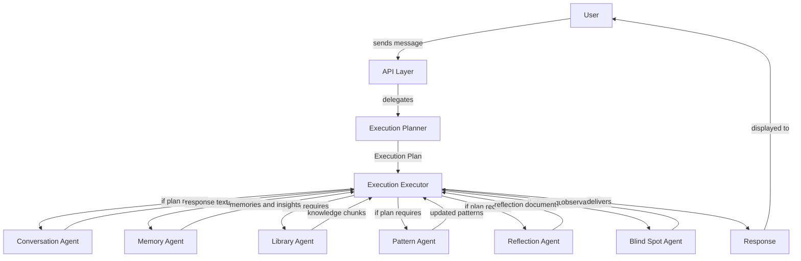

# Agent Runtime — Overview

---

## Purpose

Ayeneh's cognitive capabilities are distributed across six agents, each with a single responsibility. If agents called each other directly, the system would form an implicit dependency graph — difficult to reason about, hard to test, and fragile to change. A new agent or a changed call order would ripple through existing agents.

The Agent Runtime solves this by acting as the sole orchestrator. It owns the sequence of agent invocations, the flow of context between them, and the handling of failures. Agents never know about each other. They receive input, produce output, and return control to the runtime. The runtime decides what happens next.

The runtime is not a fixed sequential pipeline. It uses **Dynamic Execution Planning** (see ADR-007): an Execution Planner determines which agents should participate in a request, and an Execution Executor runs the generated plan. This allows the system to skip agents that are irrelevant to a given request, reducing latency and cost.

This separation means:

- Adding a new agent does not require modifying any existing agent.
- Changing the orchestration order does not require changing agent logic.
- Testing an agent in isolation requires only mocking the services it depends on, not the agents that surround it.
- The runtime is the single place where the system's execution strategy is defined and visible.

---

## Runtime Responsibilities

The runtime is responsible for the complete lifecycle of a request, from ingestion to response delivery.

### Receiving a Request

The runtime accepts a request from the API layer. The request carries the User's message, the conversation identifier, and any request-scoped metadata. The runtime validates that the request is well-formed and that the User is authenticated before proceeding.

### Planning Execution

The **Execution Planner** evaluates the request and determines which agents should participate. It uses a hybrid strategy:

1. **Rule-based planning** (first stage): A deterministic rule engine evaluates the request against known patterns and matches to pre-defined Plan Templates. This is fast and requires no LLM call.
2. **LLM-assisted planning** (second stage, conditional): When the rule engine cannot confidently determine the plan — due to ambiguity, novel request patterns, or conflicting template matches — the LLM is invoked to produce a custom plan.
3. **Plan validation**: The generated plan is validated against agent availability, budget limits, and safety rules before execution.

The output is a structured Execution Plan — an ordered list of agent steps with input bindings and error strategies.

### Creating an Execution Context

The **Execution Executor** assembles the execution context — the set of data that agents will read from and write to during processing. The context includes the current message, conversation history, user profile, and any pre-loaded state. The context is the runtime's internal working set; agents receive slices of it, not the whole.

### Executing the Plan

The Executor invokes agents in the order specified by the Execution Plan. Each agent receives its required input from the execution context, performs its single responsibility, and returns structured output. The Executor does not pass agent output directly to the next agent — it processes, validates, and stores each output before feeding it into subsequent steps.

Not every agent runs on every request. The plan determines which agents participate. A simple greeting may only invoke the ConversationAgent and MemoryAgent. A reflection request may invoke the full chain.

### Collecting Outputs

After each agent execution, the Executor collects the output, validates its structure, and stores it in the execution context or persists it through the service layer. Outputs are never passed raw between agents. The Executor acts as the buffer and validator between every step.

### Handling Failures

When an agent fails — whether due to a transient error, an invalid output, or an unreachable dependency — the Executor handles the failure according to the plan's error strategy. It applies retry logic for transient failures, graceful degradation for partial failures, and error reporting for non-recoverable failures. The Executor never propagates an agent failure to another agent; it absorbs the failure and determines the next safe step.

### Publishing Events

After significant state changes — a message stored, a memory extracted, a pattern updated, a reflection created — the runtime publishes domain events. Events are the mechanism by which background processes (the Worker) learn about state changes and enqueue async jobs. The runtime publishes events through the service layer, never directly to consumers.

### Returning the Final Response

After all planned agents have executed and all outputs have been collected, the runtime assembles the final response and returns it to the API layer. The response includes the conversational text, any inline references, and metadata about what processing occurred. The runtime's job ends when the response is delivered.

---

## Runtime Principles

These principles are non-negotiable. They define the boundary between what the runtime does and what it must never do.

### Agents Never Call Other Agents Directly

Agents are isolated cognitive units. They have no knowledge of each other's existence, interface, or output format. The runtime is the only entity that knows the full set of agent invocations. This ensures that changing one agent's output does not break another agent — it breaks the runtime, which is the single point of orchestration.

### Runtime Owns Orchestration

The runtime defines the order in which agents execute, the conditions under which they are skipped, and the strategy for handling their failures. Orchestration logic lives exclusively in the runtime — first in the Planner (which determines what to run), then in the Executor (which runs it). Agents contain zero orchestration logic — they receive input, do work, and return output.

### Agents Are Stateless

Agents hold no persistent state between invocations. Every call to an agent is a fresh computation with externally assembled input. State lives in the service layer (databases, vector stores) and in the execution context (the runtime's working set). Agents read state, produce output, and discard everything when they return.

### Context Flows Through the Runtime

The execution context is the runtime's internal data structure. It flows downward through the agent sequence, accumulating output at each step. Agents receive a view of the context relevant to their task and produce output that the runtime integrates. No agent sees the full context — only what the runtime chooses to provide.

### Services Perform Business Logic

Agents are cognitive units, not business logic containers. Business logic — memory retrieval, knowledge search, pattern detection, reflection synthesis — lives in domain services. Agents orchestrate calls to these services and interpret their results. The runtime invokes agents; agents invoke services. This two-layer delegation keeps both agents and services independently testable.

### Runtime Never Contains Domain Knowledge

The runtime does not know what a Memory is, what a Pattern means, or how a Reflection is synthesized. It knows only the plan steps, the input/output contracts of each agent, and the failure handling strategy. Domain knowledge lives in agents and services. The runtime is a pure orchestrator — it moves data, it does not interpret it.

---

## High-Level Runtime Diagram

The diagram shows the Planner as the decision-maker and the Executor as the runner. Every agent connects only to the Executor — never to each other, never to the Planner. The Planner determines what runs; the Executor runs it. This is the invariant that the runtime enforces.
