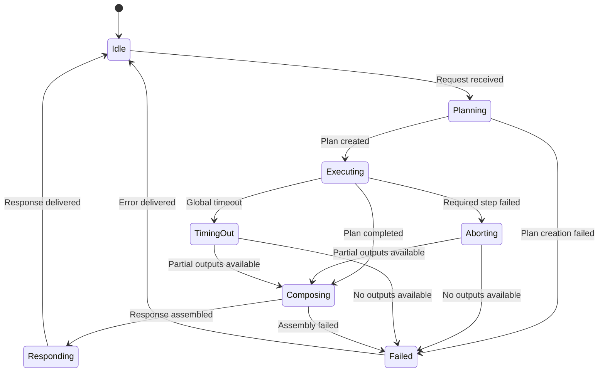
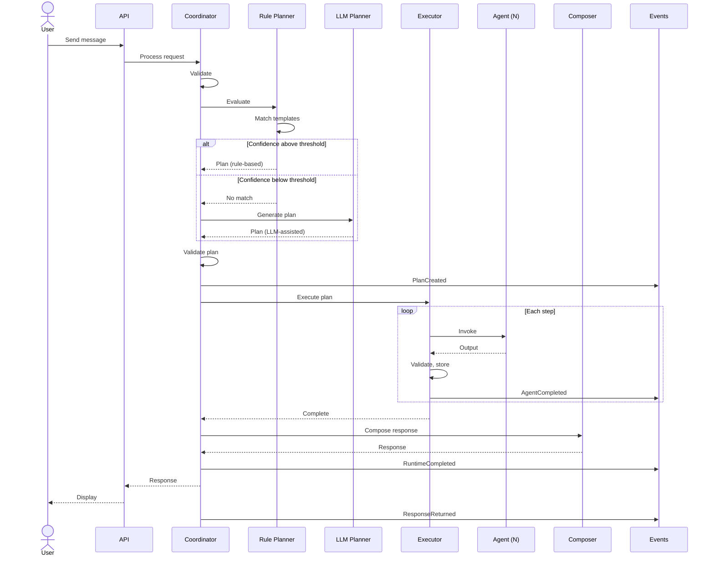

# Agent Runtime — Design

---

## 1. Runtime Goals

The Agent Runtime is Ayeneh's execution backbone. It takes a user request, determines what work needs to be done, executes that work by invoking the appropriate agents, and returns a coherent response — without containing domain knowledge, owning data, or coupling agents to each other.

- **Dynamic agent selection**: Only agents relevant to a given request are invoked.
- **Deterministic common paths**: Rule-based planning handles the majority of requests without LLM overhead.
- **Adaptive complex paths**: LLM-assisted planning handles ambiguous or novel requests.
- **Fault tolerance**: A single agent failure does not crash the request.
- **Observability**: Every execution is traceable — which plan ran, which agents participated, what failed.
- **Extensibility**: New agents are registered with the Planner. No existing runtime code changes.

---

## 2. Runtime Responsibilities

1. Receive the request from the API layer.
2. Validate the request (authentication, structure, budget).
3. Plan which agents to invoke and in what order.
4. Assemble the execution context.
5. Execute the plan — invoking agents sequentially (or in parallel when dependencies allow).
6. Collect and validate each agent's output.
7. Handle failures according to per-step error strategies.
8. Compose the final response from agent outputs.
9. Publish runtime and domain events.
10. Return the response to the API layer.

The runtime does not own data, does not contain business rules, and does not decide what agents produce — only which agents run.

---

## 3. Runtime Components

| Component | Responsibility |
|---|---|
| **Runtime Coordinator** | Top-level entry point. Receives requests, delegates to Planner then Executor, returns response. Owns the runtime lifecycle. Does not interpret agent outputs. |
| **Execution Planner** | Determines which agents participate and in what order. Delegates to Rule Planner first, escalates to LLM Planner when rules are insufficient. Validates the plan. Stateless. |
| **Rule Planner** | Deterministic fast path. Evaluates request against Plan Templates. Returns plan with confidence score. Never calls the LLM. |
| **LLM Planner** | Adaptive expensive path. Invoked when Rule Planner confidence is below threshold. Sends request, context, and agent catalog to LLM. Returns structured plan. Output validated by Planner. |
| **Execution Executor** | Runs the validated plan. Invokes agents in order, passes input, collects outputs, handles per-step failures, publishes events. Does not decide what runs. |
| **Execution Context** | Runtime's working data structure. Carries request data, conversation history, user profile, agent outputs, and mutable state. Agents receive views, not the whole. |
| **Event Publisher** | Publishes runtime and domain events through the service layer. Fire-and-forget — runtime never waits for consumers. |
| **Response Composer** | Assembles final response from agent outputs. Primary: ConversationAgent text. Secondary: metadata (memories, insights, observations). Validates well-formedness. |
| **Failure Manager** | Handles planner, agent, and runtime failures. Applies retry, circuit breaking, graceful degradation. Never throws — absorbs and determines safe continuation. |
| **Observability Layer** | Records events, traces, plan metadata, failures. Supports debugging and audit. Passive — never influences execution. |

---

## 4. Execution Context

Created per-request, discarded after response delivery. Never persisted.

**Immutable request data** (set once, never modified):

- Request identifier, User identifier, Conversation identifier.
- User message, request metadata (timestamp, platform, device, session ID).
- User profile (preferences, LLM provider, reflection cadence, privacy settings).
- Conversation history (recent Messages, bounded by configurable window).

**Mutable runtime state** (modified by Executor):

- Execution plan, agent outputs (map of step ID to output), accumulated context (retrieved memories, knowledge chunks, prompt context, response text).
- Step statuses (pending, running, completed, failed, skipped).
- Error log, event log.

**Lifecycle**: Created by Coordinator → populated by Planner → mutated by Executor → read by Composer → discarded.

---

## 5. Execution Plan

Structured, transient artifact — produced by the Planner, consumed by the Executor.

**Execution Graph**: A directed acyclic graph (DAG). Nodes are steps, edges are data dependencies. A step depending on another's output cannot start until the dependency completes.

**Execution Steps** — each describes a single agent invocation:

- Step identifier (unique within plan), agent name, input binding (data from context or previous steps), expected output type, error strategy (retry/skip/abort/degrade), timeout, optional flag.

**Dependencies**: Define execution order. Dependency-free steps can run in parallel (future optimization). Planner resolves dependencies when constructing the graph.

**Optional Agents**: Skipped if dependencies fail rather than aborting the plan. Example: BlindSpotAgent — if it fails, response returns without observations.

**Conditional Branches**: A step executes only if a context condition is met. Example: "invoke LibraryAgent only if user has indexed books." Executor evaluates before invoking.

**Termination Rules**:
- Normal: All required steps completed → response composed.
- Abort: Required step failed, no recovery → partial response or error.
- Budget: Exceeded (LLM calls or time) → remaining steps skipped, partial response if available.
- Timeout: Global timeout exceeded → all work abandoned, error response.

---

## 6. Planner Architecture

Implements the Hybrid Planning Strategy from ADR-007.

### Rule Evaluation

The Rule Planner evaluates the request against Plan Templates. Each template defines match conditions, agent sequence, input bindings, and error strategies. The Planner scores each template and returns the best match with a confidence score.

### Confidence Evaluation

Based on match specificity, ambiguity count (how many templates match with similar scores), and historical accuracy. If confidence exceeds threshold, the template plan is used directly.

### Escalation to LLM Planner

When confidence is below threshold, the LLM receives the request, context, agent catalog, and budget constraints. It returns a structured plan, which the Planner validates.

### Plan Validation

Both rule-generated and LLM-generated plans are validated:

- Agent existence (every name must be registered).
- Agent availability (not disabled, not circuit-broken).
- Budget compliance.
- Dependency validity (every reference is a valid step).
- Safety rules (certain agents restricted in certain contexts).

Invalid plans are rejected. The Planner may retry with a simplified plan or escalate to a fallback template.

### Plan Normalization

After validation: redundant steps removed, dependency-free steps ordered for parallel execution, optional steps marked with skip conditions, timeouts assigned from defaults.

---

## 7. Executor Architecture

**Sequential execution** (default): Agents invoke one at a time in plan order. Safest mode — failures isolated, outputs deterministic.

**Future parallel execution**: Dependency-free steps may run concurrently, subject to configurable concurrency limit. Optimization, not requirement.

**Cancellation**: Cooperative. On user disconnect or global timeout, Executor signals cancellation. Agents must check and terminate. Partial outputs discarded.

**Timeout handling**: Every step has a timeout. Exceeded steps terminated, error strategy applied. Global timeout caps total execution — remaining steps skipped.

**Retries**: Steps with retry strategy re-invoked up to configurable max with exponential backoff. Same input each retry. All retries failed → step marked failed.

**Partial failures**: Steps with skip/degrade strategy allow continuation. Failed output absent from context. Dependent steps handle missing input. Composer assembles from available outputs.

**Output collection**: After each invocation — receive output, validate against expected type, store in context under step ID, update status, publish AgentCompleted.

---

## 8. Runtime Events

Published at key lifecycle points. Named in past tense.

| Event | When Published |
|---|---|
| **RuntimeStarted** | Request received and validated. |
| **PlanCreated** | Planner produced a valid Execution Plan. |
| **PlanEscalated** | Rule Planner escalated to LLM Planner. |
| **PlanRejected** | Planner could not produce a valid plan. |
| **AgentStarted** | Executor begins invoking an agent. |
| **AgentCompleted** | Agent returned output successfully. |
| **AgentFailed** | Agent invocation failed (after retries). |
| **AgentSkipped** | Optional agent skipped due to dependency failure or condition. |
| **StepRetried** | Step is being retried after failure. |
| **PlanCompleted** | All required steps finished. |
| **PlanAborted** | Required step failed with no recovery. |
| **RuntimeCompleted** | Response composed and returned to API. |
| **RuntimeFailed** | Runtime could not produce any response. |
| **ResponseReturned** | Final response delivered to the user. |

---

## 9. Failure Model

### Recoverable Failures

Transient errors: LLM timeouts, database connection loss, embedding failures. Failure Manager applies exponential backoff with jitter. Max retries configurable per step.

### Non-Recoverable Failures

Permanent errors: invalid agent output, missing registration, budget exceeded, auth failure. Step marked failed, error strategy applied.

### Planner Failures

If no valid plan can be produced, the runtime falls back to a minimal default plan (ConversationAgent only) or returns an error. The Planner never blocks indefinitely.

### Agent Failures

Isolated to the step. Failure Manager applies the step's error strategy. Never propagated to other agents. Executor continues unless failure triggers abort.

### Runtime Failures

Unhandled exceptions, resource exhaustion, global timeout — Failure Manager catches, logs to Observability Layer, returns generic error. Never crashes silently.

### Circuit Breaker

Agents failing repeatedly enter a circuit-broken state. Planner excludes them from future plans. Resets after cooldown. Prevents a failing agent from degrading every request.

### Graceful Degradation

Partial success over total failure. If MemoryAgent fails but ConversationAgent succeeds, response returns without memory enrichment. If LibraryAgent fails, response proceeds without knowledge context. User receives a response with metadata indicating what was skipped.

---

## 10. Runtime State Machine

- **Idle**: Waiting for request.
- **Planning**: Planner evaluating request, producing plan.
- **Executing**: Executor running plan, invoking agents.
- **Aborting**: Required step failed, tearing down.
- **TimingOut**: Global timeout reached, abandoning work.
- **Composing**: Response Composer assembling from available outputs.
- **Responding**: Delivering response to API.
- **Failed**: Could not produce response, returning error.

---

## 11. Runtime Sequence

---

## 12. Extensibility

Adding a new agent requires:

1. **Register** with the Planner — name, capabilities, input/output contract, default error strategy.
2. **Add Plan Templates** referencing the new agent for common use cases.
3. **No changes** to Executor, Failure Manager, Observability Layer, or existing agents.

Components are agent-agnostic — they operate on step descriptors (name, input binding, output type, error strategy), not agent implementations. A new agent is a new step type in the plan. New planning rules, error strategies, or step types follow the same additive pattern.

---

## 13. Non-Goals

The Runtime must never become:

- **Business Logic**: Does not interpret Memory, Pattern, or Reflection semantics.
- **Memory Owner**: Does not store, retrieve, or manage user data.
- **Database Layer**: Does not connect to databases.
- **Prompt Builder**: Does not assemble prompts.
- **Knowledge Source**: Does not ingest, chunk, or retrieve knowledge.
- **LLM Wrapper**: Does not call LLMs directly. Agents invoke services, which invoke the LLM.
- **Event Bus**: Publishes events but does not manage routing, subscription, or delivery.
- **Scheduler**: Handles synchronous requests only. Background tasks are managed by the Worker.
