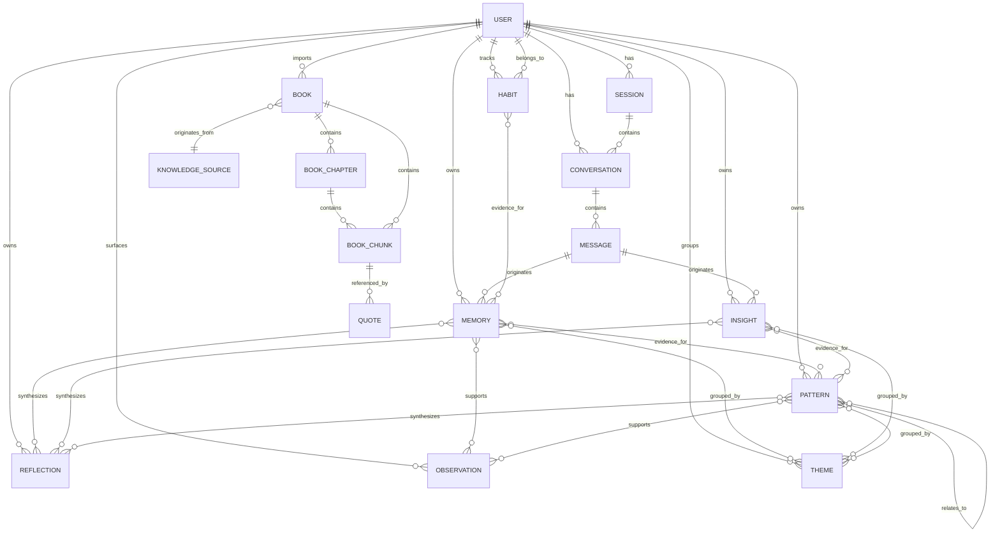

# Ayeneh — Conceptual Data Model

---

## 1. Purpose

### What This Document Is

The Conceptual Data Model defines the business objects that exist within Ayeneh's domain, the relationships between them, and the rules that govern their consistency. It is an enterprise architecture artifact — a shared vocabulary that aligns product thinking, domain experts, and engineering without prescribing implementation.

This model answers:

- What things exist in the system?
- What do they mean to the business?
- How do they relate to each other?
- Who owns them?
- How do they come into being, evolve, and disappear?
- What invariants must always hold true?

### How It Differs from Other Models

| Model | Purpose | Level of Detail |
|---|---|---|
| **Conceptual Data Model** (this document) | Defines business objects, their meaning, relationships, and ownership. Technology-agnostic. | Business concepts, no attributes, no schemas. |
| **Logical Data Model** | Defines entities, attributes, keys, and constraints. Bridges business concepts to data structures. | Entity-attribute level, no SQL, no ORM. |
| **Physical Data Model** | Defines tables, columns, indexes, partitions, and storage strategies. Implementation-specific. | SQL DDL, database-specific. |

The Conceptual Data Model is the foundation. The Logical Data Model extends it with attributes and constraints. The Physical Data Model extends that with storage specifics. Each layer adds detail; none contradicts the layer above.

This document deliberately omits:

- Database columns, types, and default values.
- Indexes, partitions, and storage strategies.
- ORM class names, decorators, or mappings.
- SQL statements of any kind.

---

## 2. Core Business Objects

Each business object is described by its purpose, who owns it, how it lives and dies, and what it connects to. These are not database tables — they are concepts in the domain.

---

### User

**Business Purpose**: The person whose cognition is being modeled. Every interaction, memory, insight, pattern, and reflection in the system belongs to exactly one User. The User is the sovereign boundary of all cognitive data.

**Ownership**: Identity Context. The User entity is the aggregate root for all personal data. No entity crosses User boundaries.

**Lifecycle**:
- **Created**: On first interaction or registration. The User record is established with default preferences.
- **Updated**: When the User changes preferences (LLM provider, reflection cadence, privacy settings) or when the system records last active time.
- **Archived**: When the User deactivates their account. The User record transitions to an inactive state. Associated data is preserved but excluded from active processing.
- **Deleted**: When the User requests permanent deletion. All associated data — Conversations, Memories, Insights, Patterns, Reflections, Observations, Books — is irreversibly removed. The User record itself is deleted.

**Relationships**: Has many Conversations, Sessions, Memories, Insights, Patterns, Reflections, Observations, BlindSpots, Themes, Books.

---

### Session

**Business Purpose**: A continuous period of interaction. The Session provides a temporal anchor — it tells the system when the User was present and for how long. Sessions influence retrieval weighting: recently active Sessions contribute higher recency signals.

**Ownership**: Conversation Context. The Session is a container for interaction periods but does not own cognitive data.

**Lifecycle**:
- **Created**: When the User connects to the application (opens the frontend, authenticates).
- **Updated**: When the User disconnects or times out. Duration and conversation count are recorded.
- **Archived**: Sessions are never archived separately — they are cleaned up with User data deletion.
- **Deleted**: Only as part of User data deletion.

**Relationships**: Belongs to one User. Contains zero or more Conversations.

---

### Conversation

**Business Purpose**: A bounded interaction around a topic or intent. The Conversation groups Messages into a logical unit, providing temporal and thematic context for memory extraction. A Conversation is the unit of coherence — Messages within a Conversation are topically related.

**Ownership**: Conversation Context. The Conversation owns its Messages and manages their lifecycle.

**Lifecycle**:
- **Created**: Implicitly when the User sends a first message on a new topic, or explicitly when the User requests a new conversation.
- **Updated**: When new Messages are added. The Conversation's message count, last activity timestamp, and summary are maintained.
- **Archived**: When the Conversation is closed (explicitly by the User, or after a period of inactivity). The Conversation transitions to a closed state. Messages remain accessible for memory extraction.
- **Deleted**: Only as part of User data deletion. Conversations are never individually deleted — they are part of the User's cognitive history.

**Relationships**: Belongs to one User. Belongs to one Session (the Session during which it was created). Contains many Messages. Generates many Memories and Insights.

---

### Message

**Business Purpose**: The atomic unit of interaction. A single utterance from either the User or Ayeneh. The Message carries content and metadata, triggers memory extraction, and serves as the source of raw evidence for patterns. Messages are immutable — once created, they are never modified. This preserves the temporal integrity of the cognitive model.

**Ownership**: Conversation Context. The Message belongs to exactly one Conversation.

**Lifecycle**:
- **Created**: When the User sends a message or when Ayeneh generates a response.
- **Updated**: Never. Messages are immutable after creation. Corrections or clarifications create new Messages, not modifications.
- **Archived**: Never separately. Messages are deleted only as part of User data deletion.
- **Deleted**: Only as part of User data deletion.

**Relationships**: Belongs to one Conversation. References the preceding Message (for sequential context). Originates zero or more Memories. Originates zero or more Insights.

---

### Memory

**Business Purpose**: A structured representation of something learned from a Message. The Memory is the fundamental unit of persistent cognition — it answers "what does the system know about the User." Ayeneh maintains four distinct memory types, each serving a different cognitive function:

- **Episodic Memory**: Raw records of interactions and events. Answers "what happened and when."
- **Semantic Memory**: Extracted facts, beliefs, and relationships. Answers "what does the User believe or know."
- **Pattern Memory**: Detected recurring tendencies. Answers "what does the User tend to do or feel." (Note: Patterns are stored separately as first-class entities; this type in the Memory classification refers to the memory-like aspect of pattern evidence.)
- **Reflection Memory**: Higher-order synthesized observations. Answers "what has changed and what does it mean." (Note: Reflections are stored separately; this type refers to the memory-like aspect of reflection content.)

**Ownership**: Memory Context. The Memory is the single source of truth about what the system knows. No other context persists User knowledge.

**Lifecycle**:
- **Created**: By the MemoryAgent during message processing. Each Message may produce zero or more Memories.
- **Updated**: When a later Message contradicts or refines an existing Memory. Corrections create new Memories that supersede old ones — the old Memory is marked as superseded, not modified. This preserves temporal consistency.
- **Archived**: When a Memory is superseded by a newer, more specific Memory. The old Memory transitions to an archived state. It is excluded from active retrieval but preserved for audit and historical context.
- **Deleted**: Only as part of User data deletion. Individual Memories are never deleted — they are archived when superseded.

**Relationships**: Belongs to one User. Originates from one or more Messages. Referenced by Insights, Patterns, Reflections. May be grouped by Themes.

---

### Insight

**Business Purpose**: A granular observation extracted from one or more Messages. The Insight captures something noteworthy about the User's current state — a stated belief, a change in tone, a new goal, an emotional expression. Insights are building blocks: they accumulate until consumed by Pattern detection or Reflection synthesis.

**Ownership**: Memory Context. Insights are owned by the User and derived from Messages.

**Lifecycle**:
- **Created**: By the MemoryAgent during message processing, or by the Insight Extraction Service. Each Message may produce zero or more Insights.
- **Updated**: Confidence scores may be adjusted as new evidence arrives. An Insight may be refuted by contradictory evidence, but it is never deleted.
- **Archived**: Never separately. Insights are deleted only as part of User data deletion.
- **Deleted**: Only as part of User data deletion.

**Relationships**: Belongs to one User. Derived from one or more Messages. Consumed by Patterns and Reflections. May be grouped by Themes.

---

### Pattern

**Business Purpose**: A recurring tendency detected across multiple Insights or Memories over time. The Pattern answers "what does the User tend to do, feel, or believe." Patterns are grounded in evidence — every Pattern must be supported by at least two pieces of evidence from distinct time periods. A single observation does not constitute a Pattern.

**Ownership**: Pattern Analysis Context. Patterns are owned by the User and emerge from evidence.

**Lifecycle**:
- **Created**: By the PatternAgent when sufficient evidence accumulates (at least two supporting Insights or Memories from different time periods). The Pattern is created with status `active` and an initial strength score.
- **Updated**: As new evidence arrives. The Pattern's strength increases with supporting evidence and decreases with contradictory evidence. The status may transition from `active` to `weakening` to `deprecated`. Evidence references are appended.
- **Archived**: When a Pattern is deprecated by contradictory evidence. The Pattern transitions to `deprecated` status and is excluded from active retrieval. It is preserved for historical context and audit.
- **Deleted**: Only as part of User data deletion.

**Relationships**: Belongs to one User. References many Insights and Memories as evidence. May relate to other Patterns (supports, contradicts, supersedes). Feeds into Reflections. May be grouped by Themes.

---

### Reflection

**Business Purpose**: A structured document that synthesizes multiple Memories, Insights, and Patterns into a coherent narrative about the User's cognitive state. The Reflection provides a longitudinal view — it summarizes what has changed, what persists, and what may need attention. Reflections are generated periodically or on demand.

**Ownership**: Reflection Context. Reflections are owned by the User and composed from evidence owned by Memory and Pattern contexts.

**Lifecycle**:
- **Created**: By the ReflectionAgent, either on a schedule (weekly by default) or on demand. The Reflection captures a time period and references the underlying evidence.
- **Updated**: Never. A Reflection is a snapshot of a time period. If new evidence emerges, a new Reflection is generated for the updated period. Old Reflections are preserved, not replaced.
- **Archived**: Never separately. Reflections are deleted only as part of User data deletion. Older Reflections are preserved as part of the User's longitudinal history.
- **Deleted**: Only as part of User data deletion.

**Relationships**: Belongs to one User. Composed from many Memories, Insights, and Patterns (read-only references). May reference prior Reflections for continuity. Presented to the User for review.

---

### Observation

**Business Purpose**: A neutral, evidence-based statement surfaced to the User. Observations are non-judgmental by design — they present what the system has noticed without interpretation. Observations are primarily produced by the BlindSpotAgent, which identifies contradictions, gaps, and inconsistencies in the User's cognitive model.

**Ownership**: Reflection Context (or Blind Spot sub-context). Observations are owned by the User and originate from Agents.

**Lifecycle**:
- **Created**: By the BlindSpotAgent (or other Agents) when a contradiction, gap, or inconsistency is detected. The Observation is created with status `pending`.
- **Updated**: When the User acknowledges or dismisses the Observation. Status transitions to `acknowledged` or `dismissed`.
- **Archived**: Never separately. Observations are deleted only as part of User data deletion.
- **Deleted**: Only as part of User data deletion.

**Relationships**: Belongs to one User. Originates from an Agent. References underlying Memories, Patterns, or Insights as evidence.

---

### Emotion

**Business Purpose**: An affective state expressed or implied in a Message. Emotions provide emotional context for Memory extraction and Pattern detection. Emotions are not stored as first-class persistent entities — they are detected per Message and aggregated into emotional trends over time. They contribute to Pattern detection and are tracked for emotional trend analysis.

**Ownership**: Memory Context (as derived metadata on Messages and Memories). Emotions are not independently owned entities.

**Lifecycle**:
- **Created**: Detected per Message by the MemoryAgent during extraction.
- **Updated**: Never individually. Emotional trends are derived by aggregating detected emotions over time.
- **Archived**: Never. Emotions are ephemeral metadata — they exist as derived data, not persistent records.
- **Deleted**: Automatically when the originating Message is deleted.

**Relationships**: Present in Messages. Contributes to Pattern detection. Aggregated into emotional trends.

---

### Habit

**Business Purpose**: A repeated behavior or routine observed across multiple sessions. Habits are distinct from Patterns in that Habits are behavioral (what the User regularly does) while Patterns are cognitive (what the User tends to think or feel). Habits answer "what does the User regularly do."

**Ownership**: Pattern Analysis Context. Habits are owned by the User and emerge from temporal evidence.

**Lifecycle**:
- **Created**: By the PatternAgent when behavioral evidence accumulates across multiple Sessions. Created with status `active`.
- **Updated**: As new behavioral evidence arrives. Strength and status evolve.
- **Archived**: When the behavior ceases or is consciously modified by the User.
- **Deleted**: Only as part of User data deletion.

**Relationships**: Belongs to one User. Supported by temporal evidence from Memories and Sessions. May be linked to Reflections about behavioral change.

---

### Theme

**Business Purpose**: A recurring subject or topic that appears across multiple Conversations and Memories. Themes group related content under a conceptual umbrella, enabling cross-session navigation and synthesis. Themes emerge automatically as Memories accumulate and can be named or renamed by the User.

**Ownership**: Memory Context. Themes are owned by the User and emerge from content analysis.

**Lifecycle**:
- **Created**: Automatically as Memories accumulate around a common subject. The system detects thematic clustering.
- **Updated**: When new Memories are added to or removed from the Theme. Theme names may be refined or renamed by the User.
- **Archived**: When a Theme is no longer active (no new Memories for an extended period). The Theme is preserved but excluded from active navigation.
- **Deleted**: Only as part of User data deletion.

**Relationships**: Belongs to one User. Groups many Memories, Insights, and Patterns. Feeds into Reflections.

---

### PromptContext

**Business Purpose**: The complete set of instructions and data assembled for a single LLM call. The PromptContext ensures that every LLM call has the right system instructions, retrieved context, and user input. It is a transient, request-scoped assembly — it exists for the duration of one generation and is discarded after use.

**Ownership**: Prompt Context (Infrastructure). The PromptContext is not owned by any User — it is a computational artifact.

**Lifecycle**:
- **Created**: By the Prompt Builder Service for each generation request. Assembled from a versioned system prompt, retrieved Memories, retrieved BookChunks, conversation history, and the User's latest Message.
- **Updated**: Never. The PromptContext is immutable once assembled.
- **Archived**: Never. It is discarded after the LLM call completes.
- **Deleted**: Automatically after the LLM call completes. No persistence.

**Relationships**: Composed from a Prompt Template version, retrieved Memories, retrieved BookChunks, and Messages. Consumed by an AgentRun. Not stored persistently.

---

### RetrievalContext

**Business Purpose**: The result set of a memory or knowledge retrieval operation. The RetrievalContext captures what was considered during retrieval — the query, retrieved items with scores, scope, and ranking strategy. It preserves the evidence base for a given generation, enabling audit of what context influenced a response.

**Ownership**: Memory Context (or Knowledge Context, depending on the source). The RetrievalContext is a transient, request-scoped artifact.

**Lifecycle**:
- **Created**: By the Memory Retrieval Service or Knowledge Service for each retrieval request.
- **Updated**: Never. The RetrievalContext is immutable once assembled.
- **Archived**: Never. It is discarded after the generation completes.
- **Deleted**: Automatically after generation. No persistence.

**Relationships**: Produced by Memory Retrieval Service or Knowledge Service. Contains ranked Memories or BookChunks. Consumed by Prompt Builder Service.

---

### AgentRun

**Business Purpose**: A record of a single Agent execution within an Execution Plan. The AgentRun captures what happened for observability — inputs, outputs, duration, and errors. It supports debugging, audit, and performance analysis. AgentRuns are not cognitive data — they are operational telemetry.

**Ownership**: Infrastructure Context. AgentRuns are not owned by any User — they are system-level records.

**Lifecycle**:
- **Created**: By the Execution Executor when an Agent executes as part of a plan. The AgentRun records the Agent type, plan step reference, input summary, output summary, start time, and initial status.
- **Updated**: When the Agent completes or fails. Duration, final status, and error details are recorded.
- **Archived**: AgentRuns are retained for a configurable period, then purged for operational hygiene.
- **Deleted**: Automatically after the retention period expires, or as part of system cleanup.

**Relationships**: References an Agent definition and an Execution Plan step. Associated with the triggering Message or Job. Not a domain entity — an infrastructure record.

---

### ExecutionPlan

**Business Purpose**: A structured description of the work to be done for a single request. The ExecutionPlan determines which agents participate, in what order, with what input, and how failures are handled. It is produced by the Execution Planner and consumed by the Execution Executor.

**Ownership**: Infrastructure Context. ExecutionPlans are transient, request-scoped artifacts.

**Lifecycle**:
- **Created**: By the Execution Planner for each request. The plan is produced using rule-based matching or LLM-assisted planning, then validated against constraints.
- **Updated**: Never. The plan is immutable once validated.
- **Archived**: Never. The plan is discarded after execution.
- **Deleted**: Automatically after execution. No persistence.

**Relationships**: References agents by name and input/output contracts. References the execution context. Produced by the Planner, consumed by the Executor. Not stored persistently.

---

### ExecutionPlanTemplate

**Business Purpose**: A pre-defined Execution Plan for a known request pattern. Plan Templates allow the rule engine to handle common request types without LLM overhead. Examples include simple conversations, knowledge queries, and reflection requests.

**Ownership**: Infrastructure Context. Plan Templates are configuration-level artifacts.

**Lifecycle**:
- **Created**: By system configuration when new agent capabilities are registered.
- **Updated**: When agent capabilities change or new templates are added.
- **Archived**: When a template is deprecated.
- **Deleted**: When a template is no longer needed.

**Relationships**: References agents and their input/output contracts. Matched to requests by the rule engine. Persistent configuration.

---

### Book

**Business Purpose**: An external knowledge source imported into the Library. A Book is any document the User wishes to reference — a book, article, paper, or document. The Book provides structured content for chunking and embedding, and carries metadata for citation.

**Ownership**: Knowledge Context. Books belong to the Library bounded context. They have no awareness of User state.

**Lifecycle**:
- **Created**: When the User uploads a file or provides a reference. The Book is created with status `processing`.
- **Updated**: Status transitions through `processing` → `ready` or `failed`. Metadata may be updated by the User.
- **Archived**: When the User removes a Book from the Library. The Book and its BookChunks are deleted. This is a destructive operation — the content is no longer available for retrieval.
- **Deleted**: When the User removes the Book, or as part of User data deletion.

**Relationships**: Belongs to the Library (not to a User directly — Users access Books through the Library). Contains many BookChunks. Referenced by Quotes in responses.

---

### BookChapter

**Business Purpose**: A structural division within a Book. The BookChapter represents a chapter or major section, providing organizational context for BookChunks. It carries metadata (title, sequence position) that supports citation and navigation.

**Ownership**: Knowledge Context. BookChapters belong to a Book.

**Lifecycle**:
- **Created**: When a Book is ingested and the text extractor identifies chapter boundaries.
- **Updated**: Never. BookChapters are immutable structural metadata.
- **Archived**: When the parent Book is removed.
- **Deleted**: When the parent Book is removed, or as part of User data deletion.

**Relationships**: Belongs to one Book. Contains many BookChunks. Carries positional metadata for citation.

---

### BookChunk

**Business Purpose**: A semantically coherent segment of a Book. The BookChunk is the atomic unit of knowledge retrieval — it is embedded, stored, and retrieved as a single unit. Each BookChunk carries content, positional metadata (chapter, section, page), and is always attributable to a source.

**Ownership**: Knowledge Context. BookChunks belong to a Book.

**Lifecycle**:
- **Created**: When a Book is ingested and the text is split into chunks. Each chunk is embedded and stored.
- **Updated**: Never. BookChunks are immutable after creation. Re-ingestion creates new chunks and replaces old ones — it does not modify existing chunks.
- **Archived**: Never separately. BookChunks are deleted when the parent Book is removed.
- **Deleted**: When the parent Book is removed, or as part of User data deletion.

**Relationships**: Belongs to one Book. Belongs to one BookChapter (if chapter structure exists). Has a position within the Book. Carries a citation path. Referenced by Quotes.

---

### Quote

**Business Purpose**: A verbatim excerpt from a BookChunk, attributed and included in an Ayeneh response. The Quote provides direct evidence and authority, enabling the User to verify claims against source material.

**Ownership**: Knowledge Context (transient). Quotes are not stored persistently — they are reconstructed at response time from a BookChunk reference.

**Lifecycle**:
- **Created**: At response generation time, when the LLM includes a passage from a BookChunk in its response.
- **Updated**: Never. Quotes are transient and disposable.
- **Archived**: Never. Quotes are not stored.
- **Deleted**: Automatically after the response is displayed. No persistence.

**Relationships**: References one BookChunk. Included in a Message (the assistant's response). Presented to the User.

---

### KnowledgeSource

**Business Purpose**: The conceptual representation of where external knowledge originates. A KnowledgeSource abstracts the provenance of content — it may be a book, an article, a web page, an RSS feed, or an audio transcript. The KnowledgeSource carries metadata about the source (type, URL, import date) and provides provenance tracking.

**Ownership**: Knowledge Context. KnowledgeSources belong to the Library.

**Lifecycle**:
- **Created**: When a new external content type is integrated into the system. The KnowledgeSource defines the extraction and ingestion pipeline for that type.
- **Updated**: When the extraction pipeline is modified (e.g., improved chunking strategy).
- **Archived**: When the source type is deprecated.
- **Deleted**: When all content from that source type is removed.

**Relationships**: Defines the ingestion pipeline for Books. May be referenced by Books to indicate provenance. A factory-level concept — not per-Book, but per-source-type.

---

## 3. Relationships

All relationships are described conceptually, without attributes or implementation specifics.

---

### User — Session

**Type**: One-to-Many

**Description**: A User has many Sessions over their lifetime. Each Session belongs to exactly one User.

**Why it exists**: The Session tracks when the User was present. Multiple Sessions accumulate over time, providing a temporal history of the User's engagement. Sessions influence retrieval weighting — recent Sessions contribute higher recency signals.

---

### Session — Conversation

**Type**: One-to-Many

**Description**: A Session contains zero or more Conversations. Each Conversation belongs to exactly one Session.

**Why it exists**: A single Session (a continuous connection period) may span multiple Conversations (different topics). The Session provides temporal context for the Conversations within it.

---

### User — Conversation

**Type**: One-to-Many

**Description**: A User has many Conversations. Each Conversation belongs to exactly one User.

**Why it exists**: Conversations are the unit of topical interaction. A User initiates many Conversations over time, each around a different topic or intent. The User owns all Conversations within their boundary.

---

### Conversation — Message

**Type**: One-to-Many

**Description**: A Conversation contains many Messages. Each Message belongs to exactly one Conversation.

**Why it exists**: Messages are the atomic units of interaction. A Conversation groups Messages into a coherent exchange. The Conversation owns the lifecycle of its Messages — Messages cannot exist outside a Conversation.

---

### Message — Memory

**Type**: One-to-Many

**Description**: A Message may originate zero or more Memories. A Memory may reference one or more Messages as its source.

**Why it exists**: The MemoryAgent analyzes Messages and extracts structured Memories. A single Message may produce multiple Memories (e.g., a belief, a goal, and an emotional state). Memories trace back to their source Messages for provenance and audit.

---

### Message — Insight

**Type**: One-to-Many

**Description**: A Message may originate zero or more Insights. An Insight is derived from one or more Messages.

**Why it exists**: Insights are granular observations extracted from Messages. A single Message may yield multiple Insights. Insights trace back to their source Messages for evidence grounding.

---

### User — Memory

**Type**: One-to-Many

**Description**: A User has many Memories. Each Memory belongs to exactly one User.

**Why it exists**: All cognitive data is scoped to a single User. Memories are the persistent representation of what the system knows about the User. No Memory crosses User boundaries.

---

### User — Insight

**Type**: One-to-Many

**Description**: A User has many Insights. Each Insight belongs to exactly one User.

**Why it exists**: Insights are owned by the User and derived from the User's Messages. They are scoped to the User's cognitive boundary.

---

### Memory — Pattern

**Type**: Many-to-Many

**Description**: A Memory may serve as evidence for many Patterns. A Pattern references many Memories as supporting evidence.

**Why it exists**: Patterns are detected across multiple Memories. A single Memory may support multiple Patterns (e.g., a statement about work-life balance may contribute to both a "career focus" pattern and a "self-care neglect" pattern). Patterns require evidence from at least two distinct time periods.

---

### Insight — Pattern

**Type**: Many-to-Many

**Description**: An Insight may serve as evidence for many Patterns. A Pattern references many Insights as supporting evidence.

**Why it exists**: Patterns are detected across multiple Insights. A single Insight may support multiple Patterns. Patterns require evidence from at least two distinct time periods.

---

### Pattern — Pattern

**Type**: Many-to-Many (Self-referential)

**Description**: A Pattern may relate to other Patterns through support, contradiction, or supersession relationships.

**Why it exists**: Patterns evolve. A new Pattern may supersede an older one (the User's behavior has changed). Two Patterns may contradict each other (the User holds conflicting tendencies). A Pattern may support another (the tendencies reinforce each other). These relationships enable the system to track the evolution of the User's cognitive model.

---

### User — Pattern

**Type**: One-to-Many

**Description**: A User has many Patterns. Each Pattern belongs to exactly one User.

**Why it exists**: Patterns are scoped to the User's cognitive boundary. They emerge from the User's own Memories and Insights.

---

### User — Reflection

**Type**: One-to-Many

**Description**: A User has many Reflections. Each Reflection belongs to exactly one User.

**Why it exists**: Reflections are longitudinal summaries of the User's cognitive state. A new Reflection is generated periodically (weekly) or on demand. Old Reflections are preserved, creating a timeline of cognitive evolution.

---

### Reflection — Memory

**Type**: Many-to-Many (Read-only reference)

**Description**: A Reflection references many Memories as its evidence base. Memories are not owned by the Reflection.

**Why it exists**: A Reflection synthesizes existing Memories into a narrative. The reference is read-only — deleting a Reflection does not affect the Memories it references. Deleting a Memory that a Reflection references does not delete the Reflection (the reference becomes orphaned but the Reflection is preserved).

---

### Reflection — Insight

**Type**: Many-to-Many (Read-only reference)

**Description**: A Reflection references many Insights as its evidence base. Insights are not owned by the Reflection.

**Why it exists**: Same as Reflection — Memory. Insights are synthesized into the Reflection narrative. References are read-only.

---

### Reflection — Pattern

**Type**: Many-to-Many (Read-only reference)

**Description**: A Reflection references many Patterns as its evidence base. Patterns are not owned by the Reflection.

**Why it exists**: Same as Reflection — Memory. Patterns are synthesized into the Reflection narrative. References are read-only.

---

### User — Observation

**Type**: One-to-Many

**Description**: A User has many Observations. Each Observation belongs to exactly one User.

**Why it exists**: Observations are surfaced to the User as evidence-based statements. They are scoped to the User's cognitive boundary.

---

### Observation — Memory

**Type**: Many-to-Many (Read-only reference)

**Description**: An Observation references one or more Memories as supporting evidence.

**Why it exists**: Observations are grounded in evidence. The User can verify the Observation against the underlying Memories.

---

### Observation — Pattern

**Type**: Many-to-Many (Read-only reference)

**Description**: An Observation may reference one or more Patterns as supporting evidence.

**Why it exists**: Some Observations are derived from Pattern analysis (e.g., a contradiction between two Patterns). The Observation references the Patterns for evidence grounding.

---

### User — Theme

**Type**: One-to-Many

**Description**: A User has many Themes. Each Theme belongs to exactly one User.

**Why it exists**: Themes group related content under a conceptual umbrella. They are scoped to the User's cognitive boundary.

---

### Theme — Memory

**Type**: Many-to-Many

**Description**: A Theme groups many Memories. A Memory may belong to many Themes.

**Why it exists**: Themes emerge from clustering Memories around common subjects. A Memory about "work stress" may belong to both a "career" Theme and a "well-being" Theme.

---

### Theme — Insight

**Type**: Many-to-Many

**Description**: A Theme groups many Insights. An Insight may belong to many Themes.

**Why it exists**: Same as Theme — Memory. Insights cluster around themes.

---

### Theme — Pattern

**Type**: Many-to-Many

**Description**: A Theme groups many Patterns. A Pattern may belong to many Themes.

**Why it exists**: Same as Theme — Memory. Patterns cluster around themes.

---

### User — Habit

**Type**: One-to-Many

**Description**: A User has many Habits. Each Habit belongs to exactly one User.

**Why it exists**: Habits are behavioral tendencies scoped to the User's cognitive boundary.

---

### Book — BookChapter

**Type**: One-to-Many

**Description**: A Book has many BookChapters. Each BookChapter belongs to exactly one Book.

**Why it exists**: BookChapters provide structural organization within a Book. They carry positional metadata for citation.

---

### BookChapter — BookChunk

**Type**: One-to-Many

**Description**: A BookChapter contains many BookChunks. Each BookChunk belongs to exactly one BookChapter (if chapter structure exists; otherwise, it belongs directly to the Book).

**Why it exists**: BookChunks are the atomic units of retrieval. BookChapters provide organizational context.

---

### Book — BookChunk

**Type**: One-to-Many

**Description**: A Book has many BookChunks. Each BookChunk belongs to exactly one Book.

**Why it exists**: BookChunks are segments of a Book. The Book owns the lifecycle of its BookChunks.

---

### BookChunk — Quote

**Type**: One-to-Many (Transient)

**Description**: A BookChunk may be referenced by many Quotes. A Quote references exactly one BookChunk.

**Why it exists**: Quotes are verbatim excerpts from BookChunks. A single BookChunk may be quoted multiple times across different responses. Quotes are transient — they are reconstructed at response time, not stored.

---

### Book — KnowledgeSource

**Type**: Many-to-One

**Description**: A Book originates from one KnowledgeSource. A KnowledgeSource may produce many Books.

**Why it exists**: The KnowledgeSource abstracts the provenance of content. It tells the system where the Book came from and which extraction pipeline to use.

---

## 4. Data Ownership

Each business object belongs to exactly one bounded context. No object is owned by multiple contexts. Cross-context communication happens through domain events and service interfaces — never through direct entity access.

---

### Identity Context

**Owns**: User (identity aspects — authentication, authorization, preferences).

**Responsibility**: Manages who the User is. Handles authentication, authorization, and preference management. Does not contain cognitive data.

**Entities Owned**: User.

---

### Conversation Context

**Owns**: Session, Conversation, Message.

**Responsibility**: Manages the real-time interaction between User and Ayeneh. Owns the synchronous request-response lifecycle. No long-term state lives here — everything is transient or immediately passed to Memory.

**Entities Owned**: Session, Conversation, Message.

**Key Rule**: No cognitive data lives in this context. Everything is transient or immediately passed to Memory Context.

---

### Memory Context

**Owns**: Memory (all four types), Insight, Theme.

**Responsibility**: Owns all forms of structured knowledge about the User. Controls memory extraction, storage, retrieval, consolidation, and lifecycle. The single source of truth about what the system knows.

**Entities Owned**: Memory, Insight, Theme.

**Key Rule**: Memory is the single source of truth. No other context persists User knowledge.

---

### Knowledge Context

**Owns**: Book, BookChapter, BookChunk, Quote (transient), KnowledgeSource.

**Responsibility**: Owns external knowledge sources. Manages ingestion, chunking, embedding, retrieval, and citation. Has no awareness of User state.

**Entities Owned**: Book, BookChapter, BookChunk, KnowledgeSource.

**Key Rule**: Knowledge has no awareness of User state. It is a library, not a profile.

---

### Pattern Analysis Context

**Owns**: Pattern, Habit.

**Responsibility**: Owns the detection, evolution, and lifecycle of cognitive and behavioral Patterns. Patterns emerge from evidence — they are never created without supporting data.

**Entities Owned**: Pattern, Habit.

**Key Rule**: Patterns emerge from evidence. They are never created without supporting data.

---

### Reflection Context

**Owns**: Reflection, Observation.

**Responsibility**: Owns the periodic synthesis of Memories, Insights, and Patterns into structured narrative documents, and the surfacing of Observations.

**Entities Owned**: Reflection, Observation.

**Key Rule**: A Reflection never contains new facts. It synthesizes what already exists.

---

### Infrastructure Context

**Owns**: AgentRun, PromptContext (transient), RetrievalContext (transient), ExecutionPlan (transient), ExecutionPlanTemplate (configuration).

**Responsibility**: Owns cross-cutting concerns: LLM abstraction, embedding generation, logging, monitoring, configuration, and the Agent Runtime (Execution Planner and Execution Executor). This context has no domain entities — it provides services consumed by all other contexts.

**Entities Owned**: AgentRun.

**Key Rule**: Infrastructure never contains domain logic. The Planner determines what to execute; the Executor runs the plan. Neither contains business rules about Memory, Pattern, or Reflection semantics.

---

## 5. Data Lifecycle

This section describes how each business object moves through its lifecycle — from creation through archival and deletion. Lifecycle rules are enforced at the domain level, not at the storage level.

---

### Creation Patterns

Most business objects are created through one of three patterns:

1. **User-initiated**: The User performs an action that creates the object. Examples: sending a Message (creates a Message), uploading a Book (creates a Book), requesting a new Conversation (creates a Conversation).
2. **Agent-generated**: An Agent analyzes input and produces the object. Examples: MemoryAgent creates Memories and Insights, PatternAgent creates Patterns, ReflectionAgent creates Reflections.
3. **System-generated**: The system creates the object as part of infrastructure operation. Examples: Session creation on connect, AgentRun creation on Agent execution, PromptContext creation per request.

---

### Update Patterns

Objects are updated through:

1. **Incremental enrichment**: New data is appended to the object (e.g., a Pattern receives new evidence references).
2. **Status transitions**: The object moves through a lifecycle state (e.g., Book from `processing` to `ready`, Pattern from `active` to `weakening`).
3. **Supersession**: A new object replaces an old one. The old object is marked as superseded, not modified. This preserves temporal integrity (e.g., a corrected Memory creates a new Memory that supersedes the old one).

---

### Archival Patterns

Archival is the transition from active to inactive:

1. **Automatic archival**: Objects that have not been accessed or updated within a configurable period are archived (e.g., old Conversations after inactivity).
2. **Event-driven archival**: Objects are archived when a triggering event occurs (e.g., a Pattern is archived when it is superseded by a newer Pattern).
3. **No separate archive step**: Some objects are never archived — they transition directly from active to deleted (e.g., Messages, which are immutable and deleted only with User data).

---

### Deletion Patterns

Deletion in Ayeneh follows strict rules:

1. **User data deletion**: The only mechanism for permanent deletion. When a User requests deletion, all data within their boundary is irreversibly removed — Conversations, Messages, Memories, Insights, Patterns, Reflections, Observations, Books, BookChunks, Themes, Habits.
2. **Cascading deletion**: When a parent object is deleted, dependent objects are deleted. Examples: deleting a Book deletes its BookChapters and BookChunks. Deleting a Conversation deletes its Messages.
3. **Supersession is not deletion**: When a Memory is superseded by a newer one, the old Memory is marked as superseded — it is not deleted. This preserves the historical record.
4. **Reflection deletion is independent**: Deleting a Reflection does not delete the Memories, Insights, or Patterns it references. The references become orphaned but the underlying data is preserved.

---

## 6. Mermaid ER Diagram

The following diagram shows all business objects and their relationships. Attributes are deliberately omitted — this is a conceptual model, not a physical schema.

---

## 7. Consistency Rules

Consistency rules are business invariants that must always hold true. They are enforced at the domain level, regardless of the underlying storage technology.

---

### User Data Boundary

**Rule**: No entity, event, or operation spans multiple Users. Every query, retrieval, and mutation is scoped to exactly one User.

**Enforcement**: All service interfaces accept a User identifier as a required parameter. No service method operates across User boundaries. Cross-User queries are structurally impossible.

**Rationale**: Ayeneh models individual cognition. There is no concept of "shared" or "collaborative" cognitive data. Each User's model is entirely independent.

---

### Message Immutability

**Rule**: Messages are never modified after creation. Corrections or clarifications produce new Messages, not modifications to existing ones.

**Enforcement**: Message entities are immutable. No update operation exists on Message objects. New content is always created as a new Message with a new sequence position.

**Rationale**: Messages are the raw evidence for the cognitive model. Modifying them after the fact would corrupt the temporal integrity of the system's understanding.

---

### Memory Type Integrity

**Rule**: A Memory has exactly one type (episodic, semantic, pattern, reflection). No hybrid types exist. A single Memory cannot serve two type roles.

**Enforcement**: The Memory type is set at creation and never changes. Type-specific retrieval strategies depend on this invariant.

**Rationale**: Different memory types serve different retrieval purposes. Mixing types would degrade retrieval precision and make type-specific operations ambiguous.

---

### Temporal Consistency

**Rule**: Memories are timestamped and never retroactively changed. Corrections create new Memories that supersede old ones.

**Enforcement**: Superseded Memories are marked with a supersession reference but their original content and timestamp are preserved.

**Rationale**: The cognitive model must accurately reflect what was known at each point in time. Retroactive changes would destroy the temporal narrative.

---

### Pattern Grounding

**Rule**: Every Pattern is supported by at least two pieces of evidence (Memories or Insights) from distinct time periods. A single observation does not constitute a Pattern.

**Enforcement**: The PatternAgent checks evidence count and temporal diversity before creating or updating a Pattern. Insufficient evidence prevents Pattern creation.

**Rationale**: Patterns represent tendencies, not isolated incidents. A single observation could be an anomaly — patterns require repetition across time.

---

### Reflection Non-Ownership

**Rule**: A Reflection references Memories, Insights, and Patterns but does not own them. Deleting a Reflection has no effect on the entities it references.

**Enforcement**: Reflections store references (identifiers) to their evidence base, not copies. Deletion of a Reflection removes only the Reflection record and its references.

**Rationale**: Reflections are synthesizers, not owners. The underlying evidence must persist independently for future synthesis, pattern detection, and retrieval.

---

### Knowledge Isolation

**Rule**: Knowledge (Books, BookChunks) is a separate bounded context. No User-specific state influences knowledge ingestion or retrieval. Knowledge retrieval is stateless with respect to the User's cognitive model.

**Enforcement**: The Knowledge Context has no awareness of User state. BookChunk retrieval returns results based on query similarity, not User context. User-specific ranking is applied at the caller level (the RAG layer), not within the Knowledge Context.

**Rationale**: Knowledge is universal — the same BookChunk is equally relevant regardless of who is asking. User-specific relevance is a retrieval concern, not a knowledge storage concern.

---

### Agent Isolation

**Rule**: No Agent directly modifies state owned by another Agent's responsibility. ConversationAgent does not write Memories. MemoryAgent does not generate responses. Coordination happens at the Application Layer.

**Enforcement**: Agents depend only on service interfaces. They do not have direct access to other Agents' data stores. The Application Layer sequences Agent invocations and passes results between them.

**Rationale**: Agent isolation ensures that each Agent can be tested, replaced, and evolved independently. Cross-Agent coupling would create fragile dependencies.

---

### LLM Statelessness

**Rule**: The LLM never owns or stores User data. Every LLM call is a stateless computation. Context is always assembled externally and discarded after use.

**Enforcement**: PromptContext is assembled per-request and discarded after the LLM call. No conversational state is stored inside the LLM. The LLM is a reasoning engine, not a storage medium.

**Rationale**: LLMs are external services. Storing User data inside them would create data governance risks, vendor lock-in, and privacy concerns.

---

## 8. Future Evolution

The Conceptual Data Model is designed for additive growth. New business objects, relationships, and bounded contexts can be added without modifying existing objects or breaking existing invariants.

---

### Adding New Agents

A new Agent defines a new cognitive capability. It does not require changes to existing business objects. The new Agent:

- Reads existing objects (Memories, Insights, Patterns) through service interfaces.
- Produces output that maps to existing objects or new objects.
- Is orchestrated at the Application Layer without modifying existing orchestration flows.

Example: A `DreamJournalAgent` that processes dream descriptions and extracts dream themes. It would read Messages (dream content), produce Memories (dream events), and may produce Insights (dream symbolism). No existing objects change — new objects are created within the existing Memory and Insight boundaries.

---

### Adding New Memory Types

A new Memory type extends the existing four-type system:

1. Define the new type in the Ubiquitous Language (e.g., "Somatic Memory" — memories of physical sensations).
2. Add it to the Memory entity's type vocabulary.
3. Implement a retrieval strategy for the new type in the Memory Retrieval Service.
4. Ensure the MemoryAgent can produce it.

Existing Agents and services require no changes. The Memory entity expands to accommodate the new type, but existing types and their relationships remain unchanged.

---

### Adding New Knowledge Sources

A new knowledge source type (e.g., web pages, RSS feeds, audio transcripts) requires:

1. A new extractor component that produces standard BookChunks.
2. A new KnowledgeSource entry in the Knowledge Context.
3. No changes to Book, BookChunk, or retrieval logic.

The BookChunk entity abstracts source-specific details. As long as the new source produces standard BookChunks, the rest of the system is unaffected.

---

### Adding New Bounded Contexts

A new bounded context defines its own entities, services, and events. It communicates with existing contexts through domain events and service interfaces. The overall coordination is managed at the Application Layer.

Example: A `Health Context` that tracks exercise, sleep, and nutrition data. It would define its own entities (Workout, SleepLog, Meal), its own services, and its own events. It would communicate with the Memory Context through domain events (e.g., "WorkoutCompleted" triggers memory extraction). Existing contexts do not need to know about the Health Context.

---

### The Non-Breaking Pattern

Every expansion follows the same principle: new capabilities are additive. No existing entity, relationship, or invariant changes its contract to accommodate new functionality. Old consumers continue to work. This is achieved through:

- **Interface-based service definitions** that can be extended without modification.
- **Event-driven communication** that allows new consumers without changing producers.
- **Clear aggregate boundaries** that prevent cascading changes.
- **A Ubiquitous Language** that is extended, not revised.
- **Immutable core entities** (Message, Memory) that are never retroactively modified.

The model is designed to grow. New objects are added to existing contexts or create new contexts. New relationships are added between existing objects. New invariants are added to enforce new business rules. None of these additions require changing existing objects, relationships, or invariants.
