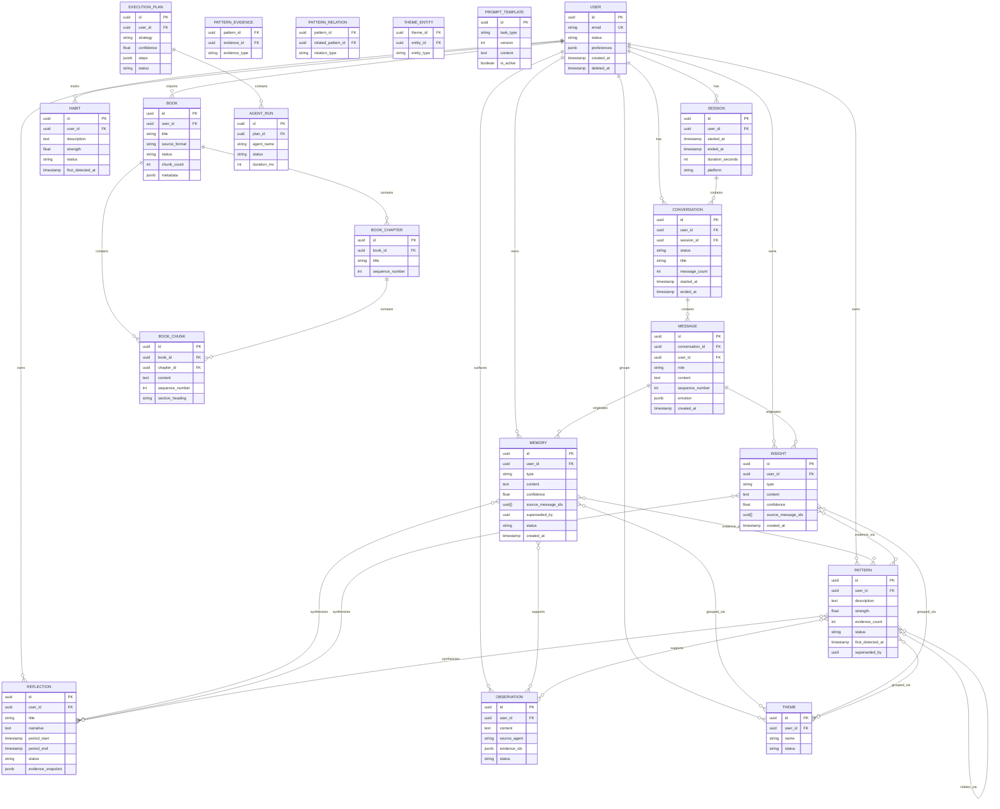

# Logical Data Model — Ayeneh

---

## 1. Design Principles

- **Conceptual fidelity**: Every Conceptual Data Model entity maps to one logical entity. No splits or merges without justification.
- **No storage artifacts**: No indexes, partitions, sequences, or database-specific constructs.
- **Relationship-first**: Cardinality and optionality drive the model, not query convenience.
- **Ownership clarity**: Every entity belongs to exactly one bounded context. Cross-context references use identifiers only.
- **Temporal traceability**: State changes recorded with timestamps and optional actor.
- **Soft deletion**: Entities are never physically removed. A `deleted_at` flag marks them inactive.
- **Immutable core**: Message, Memory, and BookChunk are logically immutable. Corrections create new records.

---

## 2. Entity Catalog

| Context | Entity | Purpose | Key Attributes | Lifecycle |
|---|---|---|---|---|
| Identity | **User** | Cognitive subject. Aggregate root. | `id`, `email`, `display_name`, `status`, `preferences` (JSON), `created_at`, `last_active_at`, `deleted_at` | Created first interaction. Soft-deleted on removal. |
| Conversation | **Session** | Interaction period. Recency weighting. | `id`, `user_id`, `started_at`, `ended_at`, `duration_seconds`, `platform`, `device`, `deleted_at` | Created on connect. Updated on disconnect. |
| Conversation | **Conversation** | Bounded topical interaction. | `id`, `user_id`, `session_id`, `topic`, `status`, `title`, `summary`, `message_count`, `started_at`, `ended_at`, `last_activity_at`, `deleted_at` | Created on first message. Closed on inactivity. |
| Conversation | **Message** | Atomic utterance. Immutable. | `id`, `conversation_id`, `user_id`, `role`, `content`, `sequence_number`, `token_count`, `emotion` (JSON), `created_at`, `deleted_at` | Created during Conversation. Never updated. |
| Memory | **Memory** | Structured knowledge unit. | `id`, `user_id`, `type`, `content`, `confidence`, `source_message_ids`, `superseded_by`, `status`, `embedding_version`, `created_at`, `updated_at`, `deleted_at` | Created by MemoryAgent. Superseded, not modified. |
| Memory | **Insight** | Granular observation. | `id`, `user_id`, `type`, `content`, `confidence`, `source_message_ids`, `created_at`, `deleted_at` | Created by MemoryAgent. Confidence adjusted. |
| Memory | **Theme** | Recurring subject. Groups content. | `id`, `user_id`, `name`, `description`, `memory_count`, `status`, `created_at`, `updated_at`, `deleted_at` | Created automatically. Named by User. |
| Memory | **ThemeEntity** | Join: Theme ↔ entity. | `theme_id`, `entity_id`, `entity_type`, `added_at` | Created on add. |
| Pattern | **Pattern** | Recurring cognitive tendency. | `id`, `user_id`, `description`, `strength`, `evidence_count`, `status`, `first_detected_at`, `last_updated_at`, `superseded_by`, `created_at`, `deleted_at` | Created on evidence. Deprecated by contradiction. |
| Pattern | **PatternEvidence** | Join: Pattern ↔ evidence. | `pattern_id`, `evidence_id`, `evidence_type`, `added_at` | Created on link. |
| Pattern | **PatternRelation** | Join: Pattern ↔ Pattern. | `pattern_id`, `related_pattern_id`, `relation_type`, `created_at` | Created on detection. |
| Pattern | **Habit** | Repeated behavioral routine. | `id`, `user_id`, `description`, `strength`, `evidence_count`, `status`, `first_detected_at`, `last_observed_at`, `created_at`, `deleted_at` | Created by PatternAgent. Updated with evidence. |
| Reflection | **Reflection** | Longitudinal narrative. | `id`, `user_id`, `title`, `narrative`, `period_start`, `period_end`, `status`, `evidence_snapshot` (JSON), `created_at`, `deleted_at` | Created periodically. Never updated. |
| Reflection | **Observation** | Evidence-based statement. | `id`, `user_id`, `content`, `source_agent`, `evidence_ids` (JSON), `status`, `acknowledged_at`, `created_at`, `deleted_at` | Created by BlindSpotAgent. Status updated on action. |
| Knowledge | **Book** | External knowledge source. | `id`, `user_id`, `title`, `author`, `source_format`, `source_url`, `status`, `chunk_count`, `metadata` (JSON), `imported_at`, `indexed_at`, `deleted_at` | Created on import. Status: processing → ready/failed. |
| Knowledge | **BookChapter** | Structural division. | `id`, `book_id`, `title`, `sequence_number`, `page_start`, `page_end`, `created_at`, `deleted_at` | Created during ingestion. Never updated. |
| Knowledge | **BookChunk** | Atomic retrieval unit. | `id`, `book_id`, `chapter_id`, `content`, `sequence_number`, `page_start`, `page_end`, `section_heading`, `token_count`, `created_at`, `deleted_at` | Created during ingestion. Never updated. |
| Infrastructure | **PromptTemplate** | Versioned system prompt. | `id`, `task_type`, `version`, `content`, `is_active`, `created_at`, `created_by` | Created on publish. Previous deactivated. |
| Infrastructure | **ExecutionPlan** | Transient plan, logged. | `id`, `request_id`, `user_id`, `strategy`, `confidence`, `steps` (JSON), `budget_llm_calls`, `budget_time_ms`, `status`, `created_at`, `completed_at` | Created per-request. Purged after retention. |
| Infrastructure | **AgentRun** | Single agent execution record. | `id`, `plan_id`, `step_id`, `agent_name`, `status`, `input_summary`, `output_summary`, `started_at`, `completed_at`, `duration_ms`, `error_message`, `retry_count` | Created on start. Purged with parent plan. |
| Infrastructure | **ExecutionPlanTemplate** | Pre-defined plan for known patterns. | `id`, `name`, `description`, `match_conditions` (JSON), `agent_sequence` (JSON), `input_bindings` (JSON), `error_strategies` (JSON), `is_active`, `created_at`, `updated_at` | Created by config. Deprecated when unused. |

---

## 3. Relationship Matrix

| Entity | Parent | Children | Cross-Context Refs |
|---|---|---|---|
| User | — | Session, Conversation, Message, Memory, Insight, Pattern, Reflection, Observation, Habit, Theme, Book | — |
| Session | User | Conversation | — |
| Conversation | User, Session | Message | — |
| Message | Conversation | Memory, Insight | — |
| Memory | User | PatternEvidence, ThemeEntity | Messages (`source_message_ids`) |
| Insight | User | PatternEvidence, ThemeEntity | Messages (`source_message_ids`) |
| Pattern | User | PatternEvidence, PatternRelation, ThemeEntity | Insights, Memories, Patterns |
| Reflection | User | — | Memories, Insights, Patterns (`evidence_snapshot`) |
| Observation | User | — | Memories, Patterns (`evidence_ids`) |
| Habit | User | — | Memories |
| Theme | User | ThemeEntity | — |
| Book | User | BookChapter, BookChunk | — |
| BookChapter | Book | BookChunk | — |
| ExecutionPlan | User | AgentRun | PromptTemplate |
| AgentRun | ExecutionPlan | — | PromptTemplate |

Cross-context references use **identifiers only** — never direct object access. Referential integrity enforced at the application layer.

---

## 4. Cardinality Rules

All parent→child: **one-to-many, optional** (0..N). Key specificities:

| Rule | Detail |
|---|---|
| ExecutionPlan → AgentRun | 1..N. Plan must have at least one step. |
| Memory → superseded_by | 0..1. Superseded by at most one newer memory. |
| PromptTemplate → ExecutionPlan | 0..N. Template may never be used. |
| User → all children | 0..N. User may have zero of any type. |

---

## 5. Aggregate Mapping

| Aggregate Root | Owns | Invariant |
|---|---|---|
| **User** | Sessions, Conversations, Messages, Memories, Insights, Patterns, Reflections, Observations, Habits, Themes, Books | No entity crosses User boundaries. |
| **Conversation** | Messages | Messages cannot exist outside a Conversation. |
| **Book** | BookChapters, BookChunks | Chunks created/replaced only through Book operations. |
| **ExecutionPlan** | AgentRuns | AgentRuns scoped to a single plan. |

Non-root entities (PatternEvidence, PatternRelation, ThemeEntity) are accessed through their roots or via service-level queries.

---

## 6. Cross-Context References

All cross-context references use identifiers only. No context directly accesses another's entities.

| From → To | Reference Field |
|---|---|
| Memory → Message | `source_message_ids` (UUID array) |
| Insight → Message | `source_message_ids` (UUID array) |
| Pattern → Insight/Memory | `PatternEvidence.evidence_id` |
| Pattern → Pattern | `PatternRelation.related_pattern_id` |
| Reflection → Memory/Insight/Pattern | `evidence_snapshot` (JSON of IDs) |
| Observation → Memory/Pattern | `evidence_ids` (JSON of IDs) |
| Theme → Memory/Insight/Pattern | `ThemeEntity.entity_id` |
| ExecutionPlan → PromptTemplate | Reference by task_type + active version |

---

## 7. Soft Delete Strategy

Every user-owned entity has `deleted_at` (nullable). Active: `NULL`. Deleted: timestamp set. Cascade: soft-deleting User → all owned entities. Soft-deleting Book → Chapters + Chunks. Restoration: set to NULL. Hard delete: reserved for retention expiry or regulatory requests. System entities (PromptTemplate, ExecutionPlanTemplate): `is_active = false`. Infrastructure entities (ExecutionPlan, AgentRun): hard-deleted after retention.

---

## 8. Versioning Strategy

**PromptTemplate**: Integer version, one active per task_type. Previous preserved for rollback.
**Memory**: Immutable. Corrections create new record with `superseded_by`. Old → `status: superseded`.
**Pattern**: Strength/status updated in place. Deprecation creates new pattern, old → `status: deprecated`.
**Reflection**: Never updated. New evidence → new Reflection. Old preserved as snapshot.

---

## 9. Audit Strategy

**Audited**: User actions (login, export, deletion), Agent executions (AgentRun), Plan executions (ExecutionPlan), Prompt changes (PromptTemplate).

**Not audited**: Individual Memory/Insight creation (covered by AgentRun), Read operations, Background job internals.

**Audit trail**: Append-only records with timestamp, actor, action, entity type, entity ID, metadata (JSON). Never modified or deleted.

---

## 10. Data Integrity Rules

**Uniqueness**: `User.email` (active users). `Message(conversation_id, sequence_number)`. `PromptTemplate(task_type, version)`. `PatternEvidence(pattern_id, evidence_id, evidence_type)`. `ThemeEntity(theme_id, entity_id, entity_type)`.

**Referential**: Every `user_id` → User. Every `conversation_id` → Conversation. Every `book_id` → Book. Every `chapter_id` → BookChapter.

**Temporal**: `ended_at ≥ started_at`. `period_end > period_start`. `completed_at ≥ started_at`.

**Business**: Memory `type` ∈ {episodic, semantic, pattern, reflection}. Pattern `strength` ∈ [0.0, 1.0]. Message `role` ∈ {user, assistant, system}. Book `status`: processing → ready | failed. Pattern `evidence_count` ≥ 0.

---

## 11. Logical ER Diagram

---

## 12. Future Evolution

**Adding entities**: New entity → define attributes, assign context, establish relationships by identifier. No existing entities modified.
**Adding join tables**: Standard pattern: parent ID, entity ID, entity type, timestamp. No existing join tables modified.
**Adding bounded contexts**: New entities with own aggregate roots. Cross-context via identifiers. No existing contexts affected.
**Schema migration path**: New entities → new tables. New attributes → nullable columns with defaults. New relationships → new join tables. Deprecated entities → soft-delete, then hard-delete after retention. No existing columns removed without migration strategy.
