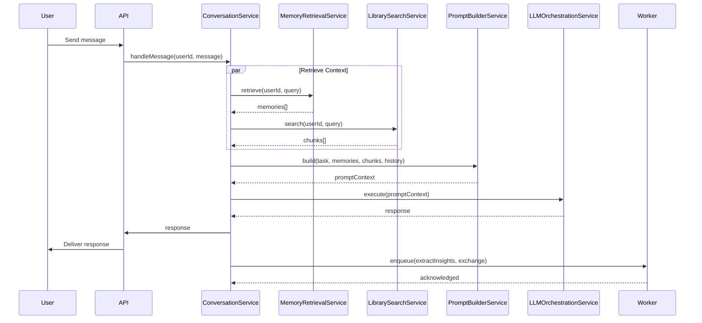
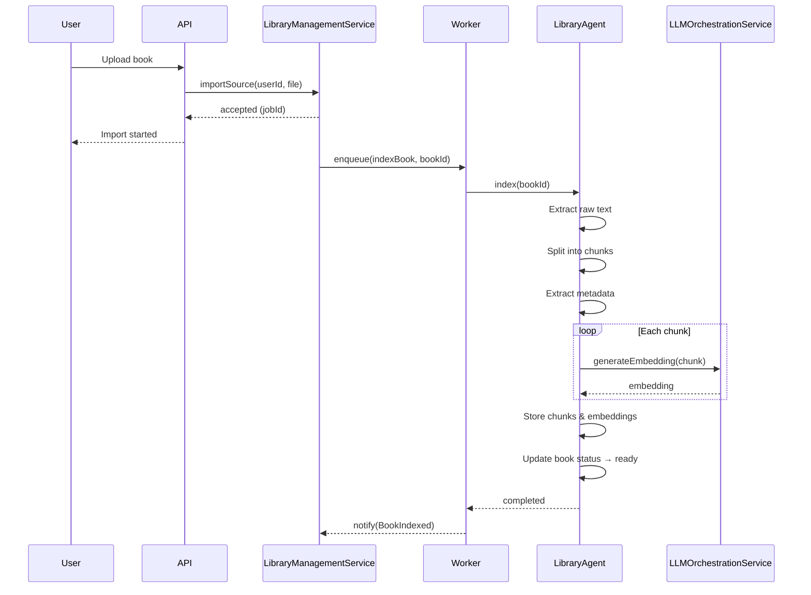
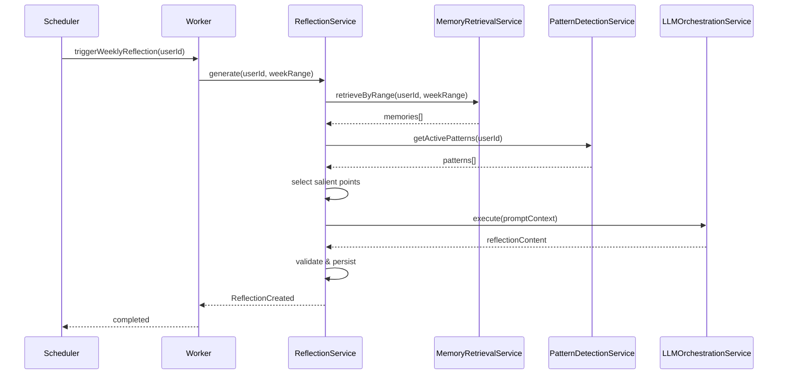
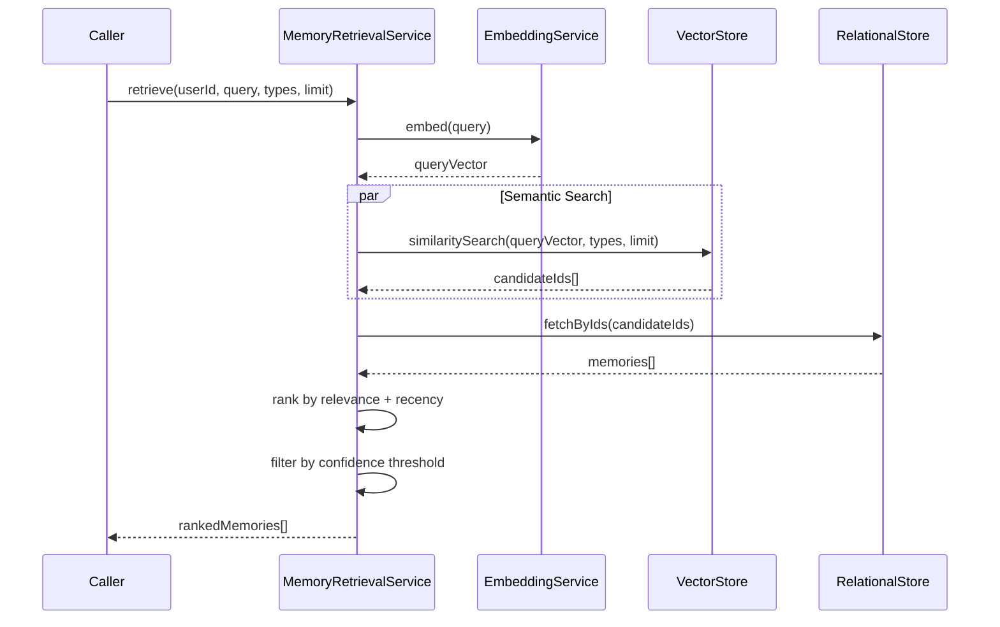

# Ayeneh — Application Use Cases

## 1. Introduction

### Role of Use Cases

Use cases define the boundary between the domain and the outside world. They describe what the system does, not how it works internally. Each use case represents a complete, meaningful interaction from the perspective of an actor.

In Ayeneh, use cases serve three purposes:
- They capture every way the system is used.
- They provide a specification that application services implement.
- They act as a contract between the domain model and the delivery mechanisms (API, CLI, worker).

### Domain Layer vs Application Layer

The **domain layer** contains the concepts, rules, and logic that are unique to Ayeneh — entities, value objects, domain services, and invariants. The domain layer has no knowledge of HTTP, queues, or external systems.

The **application layer** (use cases) coordinates domain services, manages transactions, publishes events, and handles infrastructure concerns. An application service calls domain services in sequence, but contains no domain logic itself.

This separation means domain rules can be tested independently of infrastructure, and use cases can be reorganized without changing domain concepts.

---

## 2. Actors

| Actor | Type | Responsibility |
|---|---|---|
| **User** | Primary | Initiates conversations, reviews reflections, manages library, controls data. |
| **ConversationAgent** | System | Manages the chat interaction loop: context assembly, prompt construction, response parsing. |
| **MemoryAgent** | System | Extracts structured memories from raw messages. Handles memory consolidation. |
| **PatternAgent** | System | Detects recurring cognitive and behavioral patterns over time. |
| **ReflectionAgent** | System | Generates periodic synthetic reflections from accumulated memories and patterns. |
| **LibraryAgent** | System | Ingests books, chunks text, and triggers embedding generation. |
| **BlindSpotAgent** | System | Identifies contradictions, gaps, and inconsistencies in the user's cognitive model. |
| **Worker** | System | Executes long-running, asynchronous workflows. Owns the job queue. |
| **Administrator** | Secondary | Manages system configuration, monitors health, oversees LLM provider settings. |
| **Future External Systems** | External | Placeholder for API consumers, integrations, and third-party extensions. |

---

## 3. Core User Journey

```
1. User opens Ayeneh (web/mobile/CLI).
2. User is authenticated (session resumed or new session created).
3. User sends a message (starts a new conversation or continues existing).
   │
   ├── 3a. System loads recent conversation history.
   ├── 3b. System retrieves relevant memories (episodic, semantic).
   ├── 3c. System retrieves relevant knowledge (book chunks, if applicable).
   ├── 3d. System assembles prompt context (versioned prompt + retrieved data).
   ├── 3e. System sends prompt to LLM via LiteLLM.
   ├── 3f. System parses LLM response.
   ├── 3g. Response is streamed or returned to User.
   │
   └── 3h. System extracts insights and memories from the exchange.
        └── 3i. System enqueues async jobs (pattern detection, consolidation).
             └── 3j. System may schedule periodic reflection generation.
```

From the user's perspective, they send a message and receive a response. Behind the scene, memory retrieval, knowledge retrieval, prompt building, LLM execution, and insight extraction all happen before the response is delivered. Long-term learning — pattern detection, reflection generation, memory consolidation — happens asynchronously afterward.

---

## 4. Use Cases

### 4.1 Start Conversation

| Field | Description |
|---|---|
| **Purpose** | Begin a new, topic-anchored interaction with the system. |
| **Trigger** | User explicitly starts a new conversation or sends a message with no active conversation. |
| **Preconditions** | User is authenticated. No active conversation or user explicitly requests a new one. |
| **Main Flow** | 1. System creates a new Conversation entity. 2. System creates the first Message (user input). 3. Use case continues as "Continue Conversation" from step 2. |
| **Alternative Flows** | — |
| **Failure Cases** | Authentication failure. Conversation creation fails (storage unavailable). |
| **Postconditions** | A new Conversation exists. First Message is persisted. |
| **Published Domain Events** | `MessageReceived` |
| **Involved Domain Services** | — |
| **Involved Agents** | ConversationAgent |

---

### 4.2 Continue Conversation

| Field | Description |
|---|---|
| **Purpose** | Process a user message within an existing conversation and generate a response. |
| **Trigger** | User sends a message in an active conversation. |
| **Preconditions** | Active Conversation exists. User is authenticated. |
| **Main Flow** | 1. System appends user Message to Conversation. 2. System invokes "Retrieve Relevant Memory." 3. System invokes "Retrieve Relevant Knowledge." 4. System invokes "Build Prompt Context." 5. System invokes "Generate Response." 6. System stores assistant Message. 7. System returns response to User. 8. System invokes "Extract Insights" (async). |
| **Alternative Flows** | **Streaming**: Response is streamed as it is generated. Steps 5–7 overlap. |
| **Failure Cases** | LLM call fails (timeout, provider error). Memory retrieval returns no results. Knowledge retrieval unavailable. |
| **Postconditions** | Both Messages (user + assistant) are persisted. Insights extraction is enqueued. |
| **Published Domain Events** | `MessageReceived`, `ResponseGenerated`, `MemoryStored` (after extraction). |
| **Involved Domain Services** | Memory Retrieval Service, Library Search Service, Prompt Builder Service, LLM Orchestration Service, Insight Extraction Service. |
| **Involved Agents** | ConversationAgent, MemoryAgent. |

---

### 4.3 Retrieve Relevant Memory

| Field | Description |
|---|---|
| **Purpose** | Find memories relevant to the current user message to ground the response. |
| **Trigger** | Called during Continue Conversation, before prompt assembly. |
| **Preconditions** | User message is received. Memories exist for this User. |
| **Main Flow** | 1. System builds a retrieval query from the user message. 2. System queries episodic and semantic memories by semantic similarity. 3. System ranks results by relevance and recency. 4. System filters by confidence threshold. 5. System returns ranked Memory list. |
| **Alternative Flows** | **No results**: Returns empty set. **Low confidence**: Returns empty set with a signal that no strong matches exist. |
| **Failure Cases** | Vector store unavailable. Embedding generation fails. |
| **Postconditions** | RetrievalContext is produced (may be empty). |
| **Published Domain Events** | — (internal step) |
| **Involved Domain Services** | Memory Retrieval Service. |
| **Involved Agents** | ConversationAgent. |

---

### 4.4 Retrieve Relevant Knowledge

| Field | Description |
|---|---|
| **Purpose** | Find relevant book chunks to ground the response in external knowledge. |
| **Trigger** | Called during Continue Conversation, in parallel with memory retrieval. |
| **Preconditions** | User message is received. Library contains indexed books for this User. |
| **Main Flow** | 1. System builds a retrieval query from the user message. 2. System queries BookChunk vector index by semantic similarity. 3. System ranks and filters by relevance threshold. 4. System returns ranked BookChunk list with citations. |
| **Alternative Flows** | **No results**: Returns empty set. **Library empty**: Skips knowledge retrieval entirely. |
| **Failure Cases** | Vector store unavailable. Embedding generation fails. |
| **Postconditions** | RetrievalContext (knowledge portion) is produced. |
| **Published Domain Events** | — (internal step) |
| **Involved Domain Services** | Library Search Service. |
| **Involved Agents** | ConversationAgent. |

---

### 4.5 Build Prompt Context

| Field | Description |
|---|---|
| **Purpose** | Assemble the complete input for the LLM: system prompt, retrieved context, conversation history, and user input. |
| **Trigger** | Called after memory and knowledge retrieval complete. |
| **Preconditions** | Retrieval results are available (may be empty). A versioned system prompt exists for the current task. |
| **Main Flow** | 1. System loads the correct versioned system prompt for the task type. 2. System formats retrieved Memories into context blocks. 3. System formats retrieved BookChunks into context blocks with citations. 4. System formats recent conversation history. 5. System appends the current user message. 6. System sets generation parameters (temperature, max tokens) per task. 7. System produces PromptContext. |
| **Alternative Flows** | **No retrieval results**: System prompt is included without additional context. |
| **Failure Cases** | Prompt template version not found. Mandatory parameters missing. |
| **Postconditions** | PromptContext is ready for LLM execution. |
| **Published Domain Events** | — (internal step) |
| **Involved Domain Services** | Prompt Builder Service. |
| **Involved Agents** | ConversationAgent. |

---

### 4.6 Generate Response

| Field | Description |
|---|---|
| **Purpose** | Execute the LLM call and return a structured response. |
| **Trigger** | Called after prompt context is built. |
| **Preconditions** | PromptContext is available. LLM provider is configured and reachable. |
| **Main Flow** | 1. System sends PromptContext to LLM Orchestration Service. 2. LLM Orchestration Service selects provider and calls LiteLLM. 3. System receives raw LLM output. 4. System validates output structure. 5. System parses any structured data (extracted memories, actions) from the response. 6. System returns the parsed response. |
| **Alternative Flows** | **Streaming**: Response tokens are forwarded to the User as they arrive. Parsing happens after full response is received. **Fallback**: Primary provider fails; secondary provider is used. |
| **Failure Cases** | All providers fail. Response fails validation. Response exceeds token limit. |
| **Postconditions** | Response is ready for delivery. Structured data (if any) is extracted. |
| **Published Domain Events** | `ResponseGenerated` |
| **Involved Domain Services** | LLM Orchestration Service. |
| **Involved Agents** | ConversationAgent. |

---

### 4.7 Store Conversation Message

| Field | Description |
|---|---|
| **Purpose** | Persist a message (user or assistant) to the conversation history. |
| **Trigger** | After a user message is received or after a response is generated. |
| **Preconditions** | Active Conversation exists. |
| **Main Flow** | 1. System persists the Message with role, content, timestamp, and sequence. 2. System updates Conversation metadata (message count, last activity). |
| **Alternative Flows** | — |
| **Failure Cases** | Storage unavailable. |
| **Postconditions** | Message is persisted. Conversation metadata is updated. |
| **Published Domain Events** | — (internal step) |
| **Involved Domain Services** | — |
| **Involved Agents** | — |

---

### 4.8 Extract Insights

| Field | Description |
|---|---|
| **Purpose** | Extract structured insights from a completed message exchange. |
| **Trigger** | Called after response delivery (async). |
| **Preconditions** | Response has been generated. User message and assistant response are both persisted. |
| **Main Flow** | 1. MemoryAgent receives the exchange pair (user message + response). 2. MemoryAgent invokes Insight Extraction Service. 3. System analyzes the exchange for stated beliefs, goals, emotional states, changes. 4. System produces zero or more Insights. 5. System persists Insights. 6. System publishes event. |
| **Alternative Flows** | **No insights detected**: No Insights created. Flow completes without persistence. |
| **Failure Cases** | LLM call for extraction fails. Insight validation fails. |
| **Postconditions** | New Insights are persisted (if any). Memory update event is published. |
| **Published Domain Events** | `InsightExtracted`, `MemoryStored` |
| **Involved Domain Services** | Insight Extraction Service. |
| **Involved Agents** | MemoryAgent. |

---

### 4.9 Update Patterns

| Field | Description |
|---|---|
| **Purpose** | Analyze recent Memories and Insights to detect or update cognitive Patterns. |
| **Trigger** | Scheduled (periodic) or triggered by new InsightExtracted events. |
| **Preconditions** | Sufficient new Memories or Insights exist since the last pattern analysis. |
| **Main Flow** | 1. PatternAgent retrieves recent Memories and Insights. 2. PatternAgent invokes Pattern Detection Service. 3. System analyzes for recurring themes, behaviors, emotional tendencies. 4. System creates new Patterns if sufficient evidence exists. 5. System updates existing Patterns (strength, evidence, status). 6. System persists Pattern changes. |
| **Alternative Flows** | **Insufficient evidence**: No changes made. **Contradictory evidence**: Existing Pattern strength is reduced or deprecated. |
| **Failure Cases** | LLM call for pattern detection fails. |
| **Postconditions** | Patterns are created or updated. Pattern update event is published. |
| **Published Domain Events** | `PatternUpdated` |
| **Involved Domain Services** | Pattern Detection Service. |
| **Involved Agents** | PatternAgent. |

---

### 4.10 Generate Reflection

| Field | Description |
|---|---|
| **Purpose** | Produce a structured synthetic reflection covering a period of the User's cognitive history. |
| **Trigger** | Scheduled (weekly) or user-requested. |
| **Preconditions** | Sufficient Memories, Insights, and Patterns exist for the period. |
| **Main Flow** | 1. ReflectionAgent retrieves Memories, Insights, and Patterns for the time range. 2. System selects salient points (significant changes, strong patterns, notable events). 3. System invokes LLM to synthesize a narrative. 4. System validates the Reflection structure. 5. System persists Reflection. 6. System publishes event. |
| **Alternative Flows** | **Insufficient data**: Reflection is skipped. User is notified. **Regeneration**: User requests a new version; previous Reflection is archived. |
| **Failure Cases** | LLM call fails. Validation fails. |
| **Postconditions** | A new Reflection is persisted. User is notified. |
| **Published Domain Events** | `ReflectionCreated` |
| **Involved Domain Services** | Reflection Service. |
| **Involved Agents** | ReflectionAgent. |

---

### 4.11 Detect Blind Spot

| Field | Description |
|---|---|
| **Purpose** | Identify contradictions, gaps, or inconsistencies in the User's cognitive model. |
| **Trigger** | Scheduled (periodic) or triggered by PatternUpdated events. |
| **Preconditions** | Sufficient Patterns and Memories exist for analysis. |
| **Main Flow** | 1. BlindSpotAgent retrieves current Patterns and recent Memories. 2. System cross-references Patterns for contradictions. 3. System identifies gaps between User statements and observed behavior. 4. System produces zero or more BlindSpot observations. 5. System persists observations. |
| **Alternative Flows** | **No blind spots**: No observations created. |
| **Failure Cases** | LLM call fails. |
| **Postconditions** | New BlindSpot observations are persisted (if any). |
| **Published Domain Events** | `BlindSpotDetected` |
| **Involved Domain Services** | Pattern Detection Service, Memory Retrieval Service. |
| **Involved Agents** | BlindSpotAgent. |

---

### 4.12 Search Personal Library

| Field | Description |
|---|---|
| **Purpose** | Allow the User to search their imported books and documents. |
| **Trigger** | User submits a search query via the library interface. |
| **Preconditions** | Library contains at least one indexed book. |
| **Main Flow** | 1. System embeds the search query. 2. System searches BookChunk vector index. 3. System ranks results by relevance. 4. System returns results with citations and excerpts. |
| **Alternative Flows** | **No results**: Empty result set returned. |
| **Failure Cases** | Vector store unavailable. |
| **Postconditions** | Search results are displayed to User. |
| **Published Domain Events** | — |
| **Involved Domain Services** | Library Search Service. |
| **Involved Agents** | — |

---

### 4.13 Import Knowledge Source

| Field | Description |
|---|---|
| **Purpose** | Import a new book or document into the User's personal library. |
| **Trigger** | User uploads a file or provides a URL. |
| **Preconditions** | User is authenticated. File or URL is accessible and in a supported format. |
| **Main Flow** | 1. System receives the source (file upload or URL). 2. System validates the format and size. 3. System creates a Book entity with metadata. 4. System enqueues "Index Book" job. 5. System returns confirmation to User. |
| **Alternative Flows** | **URL**: System downloads the content before validation. |
| **Failure Cases** | Unsupported format. File too large. URL unreachable. Malformed content. |
| **Postconditions** | Book entity is created in "processing" state. Indexing job is enqueued. |
| **Published Domain Events** | — (indexing completion publishes `BookIndexed`) |
| **Involved Domain Services** | — |
| **Involved Agents** | LibraryAgent. |

---

### 4.14 Index Book

| Field | Description |
|---|---|
| **Purpose** | Process an imported book: extract text, chunk, embed, and index for retrieval. |
| **Trigger** | Worker picks up the indexing job created by Import Knowledge Source. |
| **Preconditions** | Book entity exists in "processing" state. Raw content is accessible. |
| **Main Flow** | 1. LibraryAgent extracts raw text from the source. 2. System splits text into semantic chunks. 3. System extracts metadata per chunk (chapter, section, page). 4. System generates embeddings for each chunk. 5. System stores chunks and embeddings in vector store and metadata store. 6. System updates Book status to "ready." 7. System publishes event. |
| **Alternative Flows** | **Extraction failure**: Book status set to "failed" with error details. |
| **Failure Cases** | Embedding generation fails. Storage unavailable. Content cannot be parsed. |
| **Postconditions** | Book is indexed and ready for retrieval. `BookIndexed` event is published. |
| **Published Domain Events** | `BookIndexed` |
| **Involved Domain Services** | Library Search Service (for storage), LLM Orchestration Service (for embeddings). |
| **Involved Agents** | LibraryAgent. |

---

### 4.15 Weekly Reflection

| Field | Description |
|---|---|
| **Purpose** | Generate a scheduled weekly reflection summarizing the User's cognitive state. |
| **Trigger** | Worker cron schedule (weekly per User). |
| **Preconditions** | User has been active during the past week. Sufficient data exists. |
| **Main Flow** | 1. Worker triggers "Generate Reflection" with a 7-day time range. 2. Use case proceeds as "Generate Reflection" (4.10). |
| **Alternative Flows** | **Inactive user**: Reflection is skipped. |
| **Failure Cases** | Same as "Generate Reflection." |
| **Postconditions** | Weekly reflection is generated and available for User review. |
| **Published Domain Events** | `ReflectionCreated` |
| **Involved Domain Services** | Reflection Service, Memory Retrieval Service, Pattern Detection Service. |
| **Involved Agents** | ReflectionAgent. |

---

### 4.16 Memory Consolidation

| Field | Description |
|---|---|
| **Purpose** | Merge, deduplicate, and refine memories to maintain a clean cognitive model. |
| **Trigger** | Scheduled (periodic) or triggered by high memory volume. |
| **Preconditions** | Sufficient memories exist. |
| **Main Flow** | 1. MemoryAgent retrieves memories created since last consolidation. 2. System identifies duplicate or overlapping memories. 3. System merges overlapping memories (retaining evidence references). 4. System re-evaluates confidence scores. 5. System archives superseded memories. |
| **Alternative Flows** | **No duplicates**: No changes made. **Conflicting memories**: Both versions are retained; conflict is flagged for BlindSpotAgent. |
| **Failure Cases** | Storage error during merge. |
| **Postconditions** | Memory store is deduplicated. Superseded memories are archived (not deleted). |
| **Published Domain Events** | `MemoryStored` (for new consolidated memories) |
| **Involved Domain Services** | Memory Retrieval Service, Insight Extraction Service. |
| **Involved Agents** | MemoryAgent. |

---

### 4.17 Delete User Data

| Field | Description |
|---|---|
| **Purpose** | Permanently remove all data associated with a User. |
| **Trigger** | User requests account deletion. |
| **Preconditions** | User is authenticated. User confirms deletion. |
| **Main Flow** | 1. System marks User as "deleting." 2. System deletes all Messages, Conversations, Sessions. 3. System deletes all Memories, Insights, Patterns, Reflections, Observations. 4. System deletes all Books, BookChunks, and embeddings. 5. System deletes User profile and preferences. 6. System confirms completion. |
| **Alternative Flows** | **Export requested**: Export (4.18) runs before deletion. |
| **Failure Cases** | Partial deletion — system must roll back to consistent state. |
| **Postconditions** | All User data is permanently removed. User authentication is revoked. |
| **Published Domain Events** | — |
| **Involved Domain Services** | Memory Retrieval Service, Library Search Service. |
| **Involved Agents** | — |

---

### 4.18 Export User Data

| Field | Description |
|---|---|
| **Purpose** | Provide the User with a portable copy of all their data. |
| **Trigger** | User requests data export. |
| **Preconditions** | User is authenticated. |
| **Main Flow** | 1. System collects all Conversations and Messages. 2. System collects all Memories, Insights, Patterns, Reflections. 3. System collects all Books metadata (not full content unless licensed for export). 4. System packages data into a portable format (e.g., JSON, Markdown). 5. System generates a download link or delivers via email. |
| **Alternative Flows** | **Large dataset**: Export is processed asynchronously; User is notified when ready. |
| **Failure Cases** | Data collection fails partway — system must retry or report partial failure. |
| **Postconditions** | Export package is available for download. |
| **Published Domain Events** | — |
| **Involved Domain Services** | Memory Retrieval Service. |
| **Involved Agents** | — |

---

## 5. Long-running Workflows

### Book Indexing

```
Trigger: ImportKnowledgeSource enqueues job
         │
         ▼
   1. Extract raw text from source (PDF/EPUB/MD/TXT)
         │
         ▼
   2. Split text into semantic chunks
         │
         ▼
   3. Extract metadata per chunk (chapter, section, page)
         │
         ▼
   4. Generate embeddings for each chunk        ─── may batch LLM calls
         │
         ▼
   5. Store chunks in metadata store
         │
         ▼
   6. Store embeddings in vector store
         │
         ▼
   7. Update Book status → "ready"
         │
         ▼
   8. Publish BookIndexed event
```

**Characteristics**: CPU and API-bound. Chunking is deterministic; embedding is LLM-bound. May run for minutes for large books. Entirely stateless — can be retried from step 1 on failure.

---

### Embedding Generation

Embeddings are produced during book indexing and memory storage. They are not a standalone workflow but a subtask of other workflows. The embedding service is called synchronously within indexing and memory storage flows. If embedding generation fails, the parent flow fails and retries.

---

### Weekly Reflection

```
Trigger: Cron schedule (weekly per User)
         │
         ▼
   1. Determine time range (past 7 days)
         │
         ▼
   2. Retrieve Memories, Insights, Patterns for period
         │
         ▼
   3. Select salient points (rank by significance)
         │
         ▼
   4. Call LLM to synthesize narrative
         │
         ▼
   5. Validate structure
         │
         ▼
   6. Persist Reflection
         │
         ▼
   7. Notify User
```

**Characteristics**: Fully async. Requires sufficient data — skips gracefully if data is insufficient. The LLM call is the most expensive step. Each User's reflection is independent and can be parallelized.

---

### Memory Consolidation

```
Trigger: Scheduled or volume-based
         │
         ▼
   1. Retrieve memories since last consolidation
         │
         ▼
   2. Detect duplicates and overlaps
         │
         ▼
   3. Merge overlapping memories:
      - Combine evidence references
      - Recalculate confidence
      - Retain all timestamps
         │
         ▼
   4. Archive superseded memories (soft delete)
         │
         ▼
   5. Publish MemoryStored events for new consolidated memories
```

**Characteristics**: Data-intensive, not LLM-intensive. Most steps are deterministic. The merge decision may use LLM for semantic equivalence detection. Idempotent — running twice on the same data produces the same result.

---

### Pattern Evolution

```
Trigger: Periodic or InsightExtracted event
         │
         ▼
   1. Retrieve recent Insights and Memories
         │
         ▼
   2. Compare against existing Patterns
         │
         ▼
   3. For each candidate:
      ├── Match existing Pattern → update strength and evidence
      ├── Insufficient evidence → defer
      └── Contradicts existing Pattern → reduce strength or deprecate
         │
         ▼
   4. Persist Pattern changes
         │
         ▼
   5. Publish PatternUpdated event
```

**Characteristics**: Event-triggered and batch. Running frequently (event-driven) catches changes early; batch processing ensures consistency. The LLM is used for semantic comparison between new evidence and existing pattern descriptions.

---

## 6. Application Services

Application services coordinate use cases. They contain no domain logic — they call domain services, manage transactions, and publish events.

### ConversationService

Coordinates the synchronous conversation flow:
1. Calls Memory Retrieval Service.
2. Calls Library Search Service.
3. Calls Prompt Builder Service.
4. Calls LLM Orchestration Service.
5. Persists Messages.
6. Enqueues async extraction job.

### MemoryManagementService

Coordinates memory extraction and consolidation:
1. Calls Insight Extraction Service.
2. Persists Insights and Memories.
3. Triggers PatternDetectionService if volume threshold is met.

### ReflectionService

Coordinates reflection generation:
1. Calls Memory Retrieval Service to gather evidence.
2. Calls Pattern Detection Service for pattern summary.
3. Calls LLM Orchestration Service for narrative generation.
4. Persists Reflection.

### LibraryManagementService

Coordinates book import and indexing:
1. Validates source.
2. Creates Book entity.
3. Enqueues indexing job.
4. Monitors job completion.

### UserDataService

Coordinates data lifecycle:
1. Collects all User entities across contexts.
2. Packages or deletes data.
3. Ensures atomicity across contexts.

---

## 7. Sequence Diagrams

### 7.1 User Conversation



### 7.2 Book Indexing



### 7.3 Weekly Reflection



### 7.4 Memory Retrieval



---

## 8. Error Handling Philosophy

### Classification

| Category | Definition | Examples |
|---|---|---|
| **Recoverable** | Transient failures that may succeed on retry. | Network timeout, LLM provider rate limit, database connection drop. |
| **Non-recoverable** | Permanent failures that will not succeed on retry. | Invalid input, unsupported format, authentication failure, missing configuration. |

### Retry Strategy

| Workflow Type | Strategy | Max Retries | Backoff |
|---|---|---|---|
| **Synchronous (user-facing)** | Immediate retry once, then fail fast. | 2 (initial + 1 retry) | None (user is waiting). |
| **Asynchronous (worker)** | Exponential backoff with jitter. | 5 | 30s, 60s, 120s, 240s, 480s (+ random 0-10s). |
| **LLM calls** | Fallback to secondary provider before retry on primary. | 3 per provider | 5s linear. |
| **Embedding generation** | Exponential backoff. | 3 | 10s, 30s, 90s. |

### Idempotency

- Every write operation has a unique operation ID.
- The worker deduplicates jobs by operation ID.
- Memory consolidation is idempotent: running it twice on the same data produces the same result.
- Book indexing is idempotent: the same source produces the same chunks (deterministic chunking).

### Compensation

| Operation | Compensation |
|---|---|
| **Partial book indexing** | Book status set to "failed"; already-stored chunks are garbage-collected. |
| **Partial memory consolidation** | Consolidation is atomic per memory group. If the job fails mid-way, already-consolidated groups are unaffected. |
| **Partial data deletion** | All deletions are performed within a transactional scope per context. If one context fails, the entire deletion is rolled back. |
| **Failed LLM call after response partially delivered** | Streaming makes full rollback impossible. The partial response is marked as incomplete. User can request regeneration. |

### Non-recoverable Failures

Non-recoverable failures must not be retried. They are logged, reported, and either:
- Returned to the User as a clear error message (synchronous).
- Marked as "failed" in the job queue with error details (async).

---

## 9. Future Expansion

### Adding New Use Cases

New use cases follow the same pattern:
1. Define the purpose, trigger, and flow.
2. Implement an application service that coordinates domain services.
3. Wire the use case to a delivery mechanism (API route, worker job, CLI command).

No existing use case is modified. New use cases consume the same domain services through the same interfaces.

### Adding New Agents

A new Agent becomes an actor in the use case model. It uses existing domain services and may introduce new ones. The new use case registers its agent as the primary system actor. Existing use cases are unaware of the new agent.

### Adding New Workflows

Long-running workflows are added by:
1. Defining the workflow steps.
2. Implementing a worker handler.
3. Registering the trigger (cron schedule or event subscription).

The worker infrastructure is workflow-agnostic. New workflows do not require changes to the worker framework.

### Non-Breaking Extension Pattern

Every use case, workflow, and application service is an independent unit. New functionality is additive:
- New use cases do not change existing use case contracts.
- New domain services do not change existing service interfaces.
- New agents do not modify existing agent boundaries.
- New workflows use existing worker infrastructure without modification.

This ensures the use case layer can grow without accumulating technical debt or requiring regression testing of existing paths.
